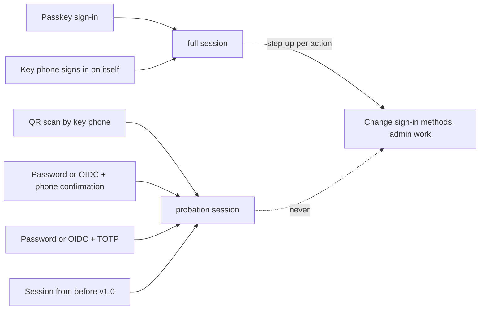

# The v1.0 login: admin guide

This guide is for the person who runs a Kaiku server: the operator (shell access to the host) and
the server admins (the admin role in the app). It covers the upgrade to v1.0, the configuration,
setting up family members, the admin tools and what to do when something fails. Every number below
is the default in the server code; where a variable changes it, the variable is named.

Related pages, which this guide links instead of repeating:

- [Setting up phones for family members](../../ops/phone-setup.md): the click path on the admin's
  phone.
- [Creating family accounts](../../ops/creating-accounts.md): creating accounts, the admin HTTP API.
- [Passkeys](../../ops/passkeys.md): `PUBLIC_URL` and the passkey domain, `assetlinks.json`,
  self-built APKs, the desktop hand-off.
- [Sign-in and recovery (host CLI)](../../ops/sign-in-and-recovery.md): the first admin's phone,
  `kaiku-admin` basics.
- [Environment variables](../../configuration/environment.md) and
  [rate limiting](../../configuration/rate-limiting.md).
- [User guide](user-guide.md) (what family members see) and
  [technical reference](technical-reference.md) (the security model in depth).

## Contents

1. [Concepts in one page](#1-concepts-in-one-page)
2. [Day 1: upgrading from rc.2 or older](#2-day-1-upgrading-from-rc2-or-older)
3. [Configuration](#3-configuration)
4. [Setting up phones for family members](#4-setting-up-phones-for-family-members)
5. [Admin mode and confirmations](#5-admin-mode-and-confirmations)
6. [A member's sign-in security panel](#6-a-members-sign-in-security-panel)
7. [Removing devices](#7-removing-devices)
8. [Account requests: delays and cancellers](#8-account-requests-delays-and-cancellers)
9. [Security log and admin notices](#9-security-log-and-admin-notices)
10. [The `kaiku-admin` host CLI](#10-the-kaiku-admin-host-cli)
11. [Throttling and anti-fatigue limits](#11-throttling-and-anti-fatigue-limits)
12. [Troubleshooting](#12-troubleshooting)
13. [Release checklist](#13-release-checklist)

## 1. Concepts in one page

- **Key phone (key device).** An Android phone with the Kaiku app whose hardware-backed key is
  enrolled for an account. Every use of the key needs the phone's screen lock. The desktop app and
  browsers are never key devices.
- **Strong authenticator.** An *active* key phone or an *active* passkey. Everything that changes
  how an account signs in rests on one of these.
- **Session assurance.** Every session is `full` or `probation` ("chat only"), fixed when it is
  created:
  - `full`: a passkey sign-in, or a key phone's own device-key sign-in;
  - `probation`: QR sign-in, password or OIDC plus phone confirmation, password or OIDC plus TOTP,
    and **every session that existed before the upgrade**.
  Probation sessions can chat, call, edit their name and photo, change notification settings, read
  the security log and sign themselves out. They cannot change sign-in methods, end other sessions,
  create bot or webhook tokens, use `/api/admin/*` (except `/api/admin/status`) or elevate.
- **Step-up (confirmation).** A single-use grant for one named action and target, valid 300 s, bound
  to one full session. Only a passkey assertion or a key phone's `device_stepup` signature produce
  one. A password, TOTP, recovery code or OIDC never do.
- **Admin mode (elevation).** A step-up for `admin.elevate` opens a 15-minute window bound to that
  session. Actions on another member's authenticators still need their own step-up each.
- **May confirm sign-ins (`may_approve`).** Whether an account's key phones may confirm sign-ins on
  other devices and offer "Add a phone". Off for accounts an admin creates, on for every other
  account. Only an admin changes it.
- **Account request.** A delayed change to an account's sign-in: self-service recovery, "Secure my
  account" (bootstrap), or an admin setup or recovery of an *existing* account. It waits
  `ACCOUNT_REQUEST_DELAY_HOURS` (24 h by default) and can be cancelled meanwhile.
- **New account.** An account that has never had a session, password, TOTP, recovery codes, OIDC
  identity or non-pending phone or passkey. Only a new account gets an admin-set-up phone at once.
- **Recovery contact.** Another member, never an admin, who receives the account's high-severity
  notices and may cancel its requests. They get no access.
- **Security notices.** Messages from the built-in system account **Kaiku** in a read-only DM, plus
  a per-account security log. High-severity ones go to the recovery contact and to every admin too.



## 2. Day 1: upgrading from rc.2 or older

v1.0.0-rc.3 contains the whole new login. The database migrations run at the first start of the
new server. Read this section **before** you deploy.

### What the migrations change

| What | Effect |
|---|---|
| Every existing session | Becomes `probation`, with `auth_methods = ["legacy"]`, client class `web` and an absolute expiry of `created_at + 30 days`. Sessions already older than 30 days end (`absolute_cap`). |
| Sessions of accounts with **neither TOTP nor** an active key phone or passkey (password-only and OIDC-only accounts: all of them before v1.0) | End at once (`upgrade`). Such accounts can no longer sign in with a password: they get the neutral sign-in answer until they have a strong authenticator. |
| Accounts with a password or an OIDC identity **and** TOTP, but no strong authenticator | Get `bootstrap_open`: they may use "Secure my account" once. Their Kaiku DM reminds them every 30 days. |
| Admin elevations (`elevated_sessions`) | All deleted. |
| `/api/admin/*` | Answer 403 `FULL_SESSION_REQUIRED` to probation sessions. Because every surviving session is probation, **no admin can use the admin area after the upgrade until they have a full session.** |
| Legacy backup codes, e-mail reset tokens | Dropped. Backup codes no longer work; recovery codes replace them. E-mail password reset is gone. |
| Temporary passwords (`must_change_password`) | Cleared. `POST /api/admin/users` no longer accepts `temporary_password`. |
| A user named `kaiku` | Renamed to `kaiku_` plus hex digits of its id (the name is reserved for the system account); the audit log records `system.username_reserved`. Tell the owner. |
| Every account | `first_activity_at` is set, so every pre-existing account counts as *existing* (not new) for admin setups. |
| Refresh tokens | Rotate into the new format at their first refresh. A token copied before the upgrade is only recognised as reused from the second refresh after the upgrade on. |

### The one rule that decides day 1

Only two things create a full session: a passkey sign-in and a key phone. Adding a passkey needs a
full session. So on an upgraded server **the first full session can only come from a key phone
set up with the host CLI**:

```bash
docker compose exec server kaiku-admin enroll <admin-username>
```

The CLI phone is active at once. Sign in on that phone (it signs itself in with its screen lock), and
from there open admin mode, set up other phones and add passkeys (see
[Sign-in and recovery](../../ops/sign-in-and-recovery.md#give-the-first-admin-a-key-phone) for the
CLI dialogue).

### Which accounts need `kaiku-admin enroll`

| Account | Day-1 situation | What to do |
|---|---|---|
| At least one admin | No full session possible otherwise. | `kaiku-admin enroll <username>` (required). |
| Further admins | Their probation sessions keep working for chat. | `kaiku-admin enroll`, or an admin setup from the first admin's phone (waits 24 h, needs a canceller, see below), or "Secure my account" if they have TOTP. |
| Family members with a password only, or OIDC only (no TOTP) | Signed out at the upgrade; password sign-in now gets the neutral answer. | `kaiku-admin enroll <username>` if they need Kaiku the same day. An admin setup from your phone also works, but waits 24 h and is refused without an independent canceller (on a server with one admin, that is usually the case on day 1). |
| Family members with password (or OIDC) + TOTP | Their old sessions are chat-only; they can sign in with password + TOTP (chat-only). | "Secure my account" (waits 24 h; you as admin with a key phone count as canceller for a non-admin's request), an admin setup, or `kaiku-admin enroll`. |
| Accounts with nobody to cancel for them | Every delayed change is refused with `NO_INDEPENDENT_CANCELLER`. | `kaiku-admin enroll`, then name and confirm a recovery contact. |

Why the canceller matters on day 1: a request records who, other than the person who started it,
could stop it. Other admins count only if they already have an active key phone or passkey, a
recovery contact only if they confirmed at least one delay period before the request started and
have one too, and the account's own strong authenticators (none on day 1). On a single-admin
server, an admin setup of an existing account has no such route until a recovery contact has been
confirmed for 24 hours. The host CLI is the deliberate way around this; every use is audited and
notified.

### Day-1 order

1. **Before the upgrade:** set `PUBLIC_URL` (the server refuses to start without it), set
   `PASSKEY_ANDROID_CERT_SHA256` if you want passkeys in the Android app (section 3), and make sure
   your proxy routes `/.well-known/` to the server.
2. Optional: tell password-only users that they will be signed out and will need their phone set up.
3. Deploy. Watch the log for startup refusals (section 12).
4. `kaiku-admin enroll <your-admin>` and sign in on that phone.
5. On your phone: admin mode, then set up the other admins and family members (section 4), or use
   `kaiku-admin enroll` for those who need it at once.
6. For your PC: get a passkey (on your phone **Add a phone → Share link**, open the link in the PC's
   browser, create the passkey, type the browser's code on the phone). Sign in on the PC with the
   passkey for admin work there.
7. Name a recovery contact for every account (also for each admin) and have them confirm it. The
   contact protects requests only from one delay period after the confirmation.
8. Consider a second admin with their own key phone: then each admin can cancel requests the
   other starts, and existing accounts always have a canceller.

### Accounts after the upgrade

- Accounts with `bootstrap_open` see **Secure my account**: password (or a fresh OIDC sign-in) plus
  a TOTP code start a request; after the delay the same client adds a phone or passkey, may set a
  new password or TOTP, and always gets recovery codes. The entitlement is used up when any
  bootstrap request completes, or when the account gets a strong authenticator another way.
- The admin user view shows `bootstrap_open` as "Can secure their account".

## 3. Configuration

All login variables are listed in [environment variables](../../configuration/environment.md);
this table explains their role.

| Variable | Default | Role |
|---|---|---|
| `PUBLIC_URL` | required | The `https://` origin users open, e.g. `https://chat.example.com`. Device signatures carry this origin, the passkey RP ID is its host, setup links point to it, OIDC returns to `$PUBLIC_URL/auth/oidc/callback`. The server does not start without it. `http://` only for `localhost`; no path, query, user name or IP address. |
| `PASSKEY_ALLOW_RP_ID_CHANGE` | unset | One-time escape hatch after a domain change (see [Passkeys](../../ops/passkeys.md#the-domain-binds-every-passkey)). |
| `PASSKEY_ANDROID_APP_IDS` | `io.wolftown.kaiku,io.wolftown.kaiku.simple` | Android package names allowed to use passkeys; `none` turns Android passkeys off. |
| `PASSKEY_ANDROID_CERT_SHA256` | the built-in official certificate | SHA-256 of the APK signing certificates, comma-separated, hex with or without colons. |
| `AUTH_HMAC_KEY` | derived from `JWT_PRIVATE_KEY` (HKDF) | 64 hex characters. Keys the hashes of setup links, sign-in tokens, codes and request secrets. Changing it (or the JWT key when it is unset) voids every open sign-in attempt, setup link and account request. |
| `ACCOUNT_REQUEST_DELAY_HOURS` | `24` | Waiting time of every account request, 24 to 72; anything else refuses startup. |
| `MAX_SESSIONS_PER_USER` | `50` | Live sessions per account, 1 to 1000; the least recently used session ends beyond it (notice `session_ended_limit`). |
| `JWT_ACCESS_EXPIRY` / `JWT_REFRESH_EXPIRY` | `900` / `604800` | Access token 15 min; refresh inactivity 7 days. The absolute caps (web 30 days, desktop and Android 90 days) are fixed in code. |
| `COOKIE_SECURE` | on in release builds | With it the browser cookies are `__Secure-kaiku_refresh`, `__Secure-kaiku_attempt`, `__Secure-kaiku_request`, `__Secure-kaiku_ticket`, `__Secure-kaiku_enroll`. The refresh cookie is always `SameSite=Strict`. |
| `RATE_LIMIT_APPROVAL_LOGIN`, `RATE_LIMIT_AUTH_FLOW`, `RATE_LIMIT_AUTH_PASSKEY` | `30,60`, `60,60`, `60,60` | Request limits of the new routes (section 11). |

### `PASSKEY_ANDROID_CERT_SHA256`, `OFFICIAL_RELEASE_CERT_SHA256` and `assetlinks.json`

Android lets an app use passkeys for a domain only if the domain publishes
`https://<host>/.well-known/assetlinks.json` naming that app and its signing certificate. The server
generates the file from configuration: one statement per app id, with the relations
`delegate_permission/common.get_login_creds` (passkeys) and
`delegate_permission/common.handle_all_urls` (setup-link App Links), and every configured
certificate as upper-case colon hex. Inside passkey assertions the same certificate appears as the
origin `android:apk-key-hash:<unpadded base64url SHA-256>`; the server accepts exactly the
configured ones.

The server has a compiled-in constant `OFFICIAL_RELEASE_CERT_SHA256` for the official release
APKs: `A0:B9:0E:57:41:12:1A:2E:AB:DA:7C:97:5B:CC:DB:48:0F:1F:6E:05:25:FA:6A:48:D5:4F:0C:F0:AE:D3:C3:5B`.
What that means:

| `PASSKEY_ANDROID_APP_IDS` | `PASSKEY_ANDROID_CERT_SHA256` | Result |
|---|---|---|
| unset | unset | Both default app ids with the official certificate. Official APKs have passkeys with no setting. |
| unset | set | Both default app ids with your certificates. |
| set | set | Your app ids with your certificates. |
| set | unset | Your app ids with the official certificate. A self-built APK needs its own certificate here. |
| `none` | unset or `none` | Android passkeys off. |
| `none` | set (or the reverse) | **Startup refused.** |

So set `PASSKEY_ANDROID_CERT_SHA256` only for APKs with another signing certificate: self-built
ones, or ones re-signed by a store (Play App Signing). How to read it
and how to check that Google can fetch the file: [Passkeys → Android](../../ops/passkeys.md#android-assetlinksjson).
Key phones do **not** need `assetlinks.json`; only passkeys inside the app and App Links do.

Setup links (`https://<host>/setup#v=1&t=…`) open the app directly only in builds made with
`-PkaikuAppLinkHosts=<host>`; otherwise the `/setup` page offers **Open in Kaiku**
([phone setup](../../ops/phone-setup.md#setup-links-and-app-links)).

## 4. Setting up phones for family members

Admin setup (spec F5c) always runs on **your own active key phone** in the Android app: Settings →
Admin → open admin mode → the person → **Set up a phone**. The click path and screenshots-in-words
are in [Setting up phones for family members](../../ops/phone-setup.md). The rules behind it:

1. **Every setup code needs its own confirmation** with your screen lock (step-up
   `admin.enrollment.issue` for that account). There is no batch.
2. **The target is never yourself** (`ENROLLMENT_TARGET_SELF`): for your own account use "Add a
   phone" on your key phone.
3. **Claimant check before any code exists.** You record how you know you are dealing with the
   right person:
   - **With me in person**: the person and the phone are with you;
   - **I called them back**: you ended the incoming call or chat, called back on a number you knew
     before, and recognised them.
   A note of 1 to 500 characters is required. Method and note are signed into the enrolment
   context and kept in the audit log.
4. **Mode.** `setup` (add a phone) or `recovery` (the old phone is lost). Only in recovery mode can
   you name lost phones; they are revoked when the request completes, not before.
5. Your phone shows the setup QR (in person) or a link to share (remote). The link carries a
   256-bit token in the URL fragment, is valid 10 minutes and works once. Opening it never uses it
   up, so link previews do no harm.
6. The new phone checks its screen lock and hardware key store first, shows "Set up Kaiku for
   <name> on <server>?", creates its key and shows a 6-digit code (valid 5 minutes). You **type**
   that code on your phone and confirm with your screen lock. Three wrong codes end the setup.
7. **Result.**
   - **New account:** the phone is active at once; every other admin gets an `admin_setup` notice.
   - **Existing account** (in person or remote, setup or recovery): an admin account request starts.
     The new phone waits `ACCOUNT_REQUEST_DELAY_HOURS` with no session, shows when it will be ready,
     and activates itself. The person's devices (including phones named lost), their recovery
     contact and all admins are told and can cancel. Refused before any code exists while the
     account has an open request (`ACCOUNT_REQUEST_OPEN`) or no independent canceller
     (`NO_INDEPENDENT_CANCELLER`); checked again when the code is confirmed.
8. **Person without a phone:** open the setup link in their computer's browser instead. The browser
   registers a passkey and shows the 6-digit code; the same rules and waits apply.

At most 5 setup codes can be open per issuer (`ENROLLMENT_LIMIT`).

**Another admin as target.** Allowed, and it waits like any existing account. The *immediate*
actions on another admin's account (section 6) are refused in the app.

### Same day with a working old phone

When the person still has a working key phone and is with you, skip the 24-hour wait: turn on **May
confirm sign-ins** for the account, let them use **Add a phone** on the old phone (their screen lock,
the new phone's code typed on the old one), and turn the switch off again. Both changes are audited
and notified (`may_approve_changed`). The 24-hour wait remains for lost or broken phones and for
remote setups.

### `may_approve`

| | Default | Effect when on |
|---|---|---|
| Accounts created by an admin | off | The account's key phones may claim sign-in QR codes on PCs (QR sign-in and password confirmation) and offer "Add a phone" |
| All other accounts | on | |

With it off, the phone refuses a sign-in QR with a friendly explanation and shows no "Add a phone";
the person signs in on the phone itself, with a passkey, or with TOTP on a PC. It never limits
"That wasn't me" or Cancel. Keep it off for the least experienced users: QR phishing aims at them.
Change it in the member's security panel (step-up `admin.may_approve`) or with
`kaiku-admin may-approve <username> on|off`. It is re-checked when the phone claims and when it
approves.

## 5. Admin mode and confirmations

- **On the Android key phone:** Settings → Admin → **Open admin mode**, confirm with the screen
  lock. Admin mode is open 15 minutes for that phone's session.
- **On a PC:** sign in with a **passkey** (a QR or password sign-in is chat-only and gets 403
  `FULL_SESSION_REQUIRED` in the admin area), then confirm admin mode with a passkey. A key phone's
  confirmation cannot elevate a PC session: device step-ups are bound to the phone's own session.
- `POST /api/admin/elevate {reason|null}` consumes an `admin.elevate` grant and records the
  elevation with `details.method` = `step_up:device` or `step_up:passkey`. `DELETE
  /api/admin/elevate` ends it for the calling session.

What needs what (server routes):

| Needs | Routes |
|---|---|
| Admin + full session | everything under `/api/admin/*` except `/api/admin/status` |
| … + admin mode (15-min elevation) | creating accounts (`POST /api/admin/users`), ban, unban, delete, guild suspension, reports, auth settings, OIDC providers, announcements, page limits, the admin security log (`GET /api/admin/security-events`), open requests (`GET /api/admin/account-requests`) |
| … + an action-bound step-up (no elevation needed by the server; the apps ask for admin mode first) | per-member actions: setup codes (`admin.enrollment.issue`), "Remove device now" (`admin.authenticator.remove`), `may_approve` (`admin.may_approve`), factor states (`admin.factor.set_state`), recovery contact (`admin.recovery_contact.set`), Cancel (`request.cancel`) |

A step-up is valid 300 s, works once, for exactly the named target, and only while the session is
live and full and the authenticator that produced it is still active.

## 6. A member's sign-in security panel

Admin Panel → Users → a member (web and desktop), or Settings → Admin → Users → a member (Android).
`GET /api/admin/users/{id}/details` returns what it shows:

- `is_admin`, `may_approve`;
- `key_devices` and `passkeys`, each `{id, label, state, ready_at, created_at, last_used_at}`;
- `password_state`, `totp_state` (`active`, `throttled`, `compromised`), `recovery_codes_left`;
- `bootstrap_open`, `recovery_contact` (and whether it is confirmed), `open_request`;
- `open_sessions {full, probation}`.

### Factor states

A password or TOTP secret is in one of three states. "Disabled" means either of the last two; a
disabled factor gets the neutral sign-in answer.

| State | Entered by | Left by |
|---|---|---|
| `active` | normal | – |
| `throttled` (password) | 100 consecutive wrong passwords | a successful sign-in of the account by another method (QR, passkey, key phone), a completed account request, an admin ("Allow again"), the CLI |
| `throttled` (TOTP) | 100 consecutive wrong codes | renewal, a completed request, an admin, the CLI; never by another sign-in |
| `compromised` (password) | "I didn't start this" on a password confirmation; "That wasn't me" on an event it produced; a cancelled request that used it; 100 TOTP failures after it; an admin | replacement or removal by the owner (full session + step-up), a completed request, the CLI |
| `compromised` (TOTP) | "That wasn't me" on an event it produced; a cancelled request that used it; an admin | renewal by the owner (full session + step-up), a completed request, the CLI |

The panel buttons (`PUT /api/admin/users/{id}/factors`, step-up `admin.factor.set_state`):

- **Mark the password / authenticator app as unsafe** (`compromised`): offered while `active` or
  `throttled`. It starts a new generation: every open sign-in attempt and account request that used
  the old one ends.
- **Allow the password / authenticator app again** (`active`): offered only while `throttled`. A
  `compromised` factor cannot be allowed again by an admin (`400 VALIDATION_ERROR`); the panel says
  the person must replace it. Only `kaiku-admin factor reset` restores a compromised factor without
  replacement.

### Other buttons

- **Phones may confirm sign-ins** (`may_approve`), section 4.
- **Recovery contact**: choose a member who is not an admin (`RECOVERY_CONTACT_INVALID` otherwise);
  they still confirm it themselves. Only for non-admin accounts.
- **Remove device now**, section 7.
- The open request with **Cancel**, section 8.

**Another admin's account.** Immediate actions (removing devices, `may_approve`, factor states, the
recovery contact) answer 403 `ADMIN_TARGET_IS_ADMIN` and the apps hide them: that admin does them
with their own strong authenticator, or the operator uses the CLI. Setup, recovery and Cancel stay
allowed, so a stolen admin phone cannot lock the other admins out. Your own account is not
"another admin's".

## 7. Removing devices

| Who | How | Delay | Notes |
|---|---|---|---|
| The owner | Settings → Security → Your phones / Passkeys → Remove (full session + step-up `key_device.remove` / `passkey.remove`) | none | Never the last strong authenticator (`LAST_STRONG_AUTHENTICATOR`). |
| The owner, on the phone itself | **Sign out and remove this phone** (screen lock) | none | Same last-authenticator rule. |
| An admin | **Remove device now** (`POST /api/admin/users/{user_id}/authenticators/{id}/remove`, step-up `admin.authenticator.remove` for that id) | none | Works on key phones and passkeys, also on the last one and on a pending one. Not on another admin's account. |
| The operator | `kaiku-admin devices remove <username> <device-id>` | none | Key phones only; also on admin accounts. |
| An account request | devices named lost are revoked when it completes | the request's delay | Naming a device lost never removes it early. |
| The owner, on a notice | "That wasn't me" on a sign-in by a phone or passkey, or on its `authenticator_added` | none | |

Removing an authenticator ends its sessions at once, voids its open challenges, its step-up grants,
the setup codes it issued and the admin requests it started, and records `authenticator_removed`
(high). A removed phone gets one last notice, then its push subscription is deleted.

**Order for a stolen phone:** remove it **first**, then start the recovery. A thief who knows the
screen lock holds a full key and could cancel the recovery. Removing a request's only recorded
canceller voids that request, so do not remove devices *during* someone's legitimate request
unless you mean to stop it. Removing a device never shortens a delay.

## 8. Account requests: delays and cancellers

| Purpose | Started by | Factors | Completes |
|---|---|---|---|
| `recovery` | the person, at "I lost my phone / forgot my password" | one recovery code + password (`active`) or TOTP (any state) or a fresh OIDC sign-in | the same client, within 24 h after ready ("Finish") |
| `bootstrap` | the person, "Secure my account" (needs `bootstrap_open`) | password or fresh OIDC + TOTP, both `active` | as recovery |
| `admin_setup`, `admin_recovery` | an admin setup of an existing account, when the code is confirmed | the admin's step-up and claimant check | automatically at `ready_at` |

Common rules:

- **One open request per account** (`ACCOUNT_REQUEST_OPEN`).
- **Delay** `ACCOUNT_REQUEST_DELAY_HOURS` (24, up to 72); there is no shorter in-person variant.
- **Start budget:** at most 3 self-service starts (recovery and bootstrap together) per account per
  delay period. Further starts get the same neutral answer as an unknown user name.
- **Independent cancellers**, recorded at the start: every *other* admin with an active strong
  authenticator (for a non-admin's own request every admin, a sole admin included); the confirmed
  recovery contact, if confirmed at least one delay period before the start and holding an active
  strong authenticator; the account's own active key phones and passkeys, including those named
  lost. Without one the start is refused (`NO_INDEPENDENT_CANCELLER`). A route added later never
  counts. If every recorded route disappears (admin demoted or without strong authenticator,
  contact changed, authenticator revoked), the request becomes `void`.
- **Who may cancel** (`POST /api/account-requests/{id}/cancel`): the owner with a step-up from a
  strong authenticator that existed before the request, or, only while the account has no active
  strong authenticator at all, from any of its sessions with a fresh TOTP or recovery code; the
  confirmed recovery contact (full session + step-up); any admin (full session + step-up), including
  the one who started it; the operator (`kaiku-admin request cancel`). The client that started a
  self-service request can only **withdraw** it (no other effect).
- **Cancel effects:** the request ends; its pending phone or passkey is dropped; for a self-service
  request the password or TOTP generation it used is marked `compromised` (the recovery code was
  already spent); for an admin request you start again with a new claimant check. Notices name who
  cancelled.
- **Void** (no factor disabled): a factor generation it used changed, every canceller is gone, the
  issuing admin was demoted or their issuing phone revoked, or (bootstrap) the entitlement was used
  up another way.
- **Notices:** at start (high, also to devices named lost), one hour before ready, at ready,
  completion, cancel, withdrawal, expiry and void, to the account, its recovery contact and all
  admins. The owner's app shows an open request full-screen with Cancel; for an admin setup it says
  "Set up by <admin>. If that is right, there is nothing to do."
- **Completion** activates the one staged phone or passkey, applies a staged password or TOTP
  (ending `throttled`/`compromised`), revokes devices named lost, uses up `bootstrap_open`, replaces
  the recovery codes (self: shown once; admin: invalidated) and, if it named devices lost or changed
  the password or TOTP, ends every other session except those of active key phones not named lost.
- **Too late:** a cancel that loses against completion answers `ACCOUNT_REQUEST_COMPLETED`; the apps
  offer "Remove device now" (admins) or "Remove this device" (owner).
- **Banned accounts:** starts answer neutrally, Finish answers `ACCOUNT_BANNED`, and a due admin
  request waits until the ban ends.

Admins see open requests under Admin Panel → open requests (`GET /api/admin/account-requests`,
admin mode) and in each member's panel.

## 9. Security log and admin notices

- Every security event is a row in `security_events` (append-only; no delete route) and, in the same
  transaction, a `system_audit_log` row with action `security.<event_type>` (actor: the acting user,
  or the system account for system and CLI events). The admin audit log therefore lists every
  sign-in change.
- Members read their own log in Settings → Security → Security log
  (`GET /api/me/security-events`, 50 per page, at most 100).
- Admins read every account's log in admin mode: `GET /api/admin/security-events?user_id=…`
  (without `user_id`, all accounts).
- **High-severity** events are copied into the Kaiku DM of the confirmed recovery contact and of
  every admin other than the subject, with event, user, device label and time. IP address and place
  appear only in the owner's own notices and log and in the admin log, never in a contact's or
  admin's DM copy.

High: `authenticator_added` (key phone or passkey), `authenticator_removed`, `key_invalidated`,
`password_throttled`, `password_compromised`, `totp_throttled`, `totp_compromised`, `repudiated`,
`request_started`, `request_completed`, `request_cancelled`, `request_withdrawn`, `admin_setup`,
`admin_role_granted`, `admin_role_removed`, `sessions_ended`, `factor_restored`,
`may_approve_changed`. All others are normal; the full list is in the
[technical reference](technical-reference.md#11-security-events-and-notices-c28).

Notices of the same type for the same account within 10 minutes are coalesced into one with a
count (up to 50 events listed); pushes for one notice go out at most once a minute. Pushes are
always high priority, bypass notification settings, and high ones also bypass quiet hours.

**Place:** v1.0 has no GeoIP lookup at all; the place field is empty. IP addresses are stored for
display and audit only.

## 10. The `kaiku-admin` host CLI

`kaiku-admin` ships in the server image next to the server and runs with the server's own
environment. Whoever can run it already controls the server, so it needs no sign-in, and it also
works on admin accounts.

```bash
docker compose exec server kaiku-admin <command>
```

Exit codes: `0` done, `2` wrong command line (the usage is printed, nothing touches the database),
`1` failure (the reason is printed, e.g. `No account named 'oma'.`).

| Command | Effect | Event / notice |
|---|---|---|
| `enroll <username>` | Prints a setup link (valid 10 min, single use) and its QR code, waits for the phone, shows "A device calling itself '<label>' wants to become <username>'s key.", asks for the 6-digit code (spaces ignored; 3 wrong codes end it). The phone is active at once, also for existing accounts. | `authenticator_added` (high) |
| `devices list <username>` | Lists key phones: id, state, label, enrolled via, added, last used. | audit only |
| `devices remove <username> <device-id>` | Revokes the key phone (id from `devices list`, not the install id): its sessions end, challenges and grants void, a last notice. | `authenticator_removed {by: cli}` (high) |
| `sessions list <username>` | Lists live sessions: id, client class, assurance, methods, device, since, last used. | audit only |
| `sessions end <username> <session-id>` | Ends one session. | `sessions_ended {count, by: cli}` (high) |
| `sessions end <username> --all` | Ends every session (the flag is required, so a missing id never ends all). | `sessions_ended` (high) |
| `factor reset <username> password` / `totp` | A `throttled` or `compromised` factor is `active` again; its counter and delay are cleared. Prints whether it was blocked. | `factor_restored` (high, was compromised) or `throttle_reset` |
| `throttle reset <username>` | Clears `throttled` states and the per-account delays of password and TOTP (not `compromised`). | `throttle_reset` per factor cleared |
| `may-approve <username> on` / `off` | Turns phone confirmations on or off. | `may_approve_changed` (high) |
| `recovery-contact <username> <contact-username>` | Names the contact (they still confirm in the app). | `recovery_contact_named` / `_changed` |
| `recovery-contact <username> --none` | Removes the contact. | `recovery_contact_changed` |
| `admin demote <username>` | Removes the admin role, ends their elevations and voids the admin requests they started. | `admin_role_removed` (high) |
| `request cancel <request-id>` | Cancels an open account request, with the normal cancel effects. | `request_cancelled` (high) |

Every command also writes its own audit row (`cli.enroll`, `cli.devices.list`,
`cli.devices.remove`, `cli.sessions.list`, `cli.sessions.end`, `cli.throttle.reset`,
`cli.recovery_contact`, `cli.admin.demote`, `cli.request.cancel`, …) with the system account as
actor. Notices are delivered right after the command; if that fails, the server's minute sweep
delivers them. Ended sessions reach the running server through PostgreSQL `NOTIFY`, so their
sockets close within seconds.

Examples:

```bash
# A family member lost their only phone and the thief may know the PIN
docker compose exec server kaiku-admin devices list oma
docker compose exec server kaiku-admin devices remove oma 0d3c…-…
docker compose exec server kaiku-admin sessions end oma --all
docker compose exec server kaiku-admin enroll oma        # new phone, active at once

# Someone hammered a password and it is throttled
docker compose exec server kaiku-admin throttle reset papa

# Stop a recovery the account holder did not start (id from the admin view or the notice)
docker compose exec server kaiku-admin request cancel 5b1f…-…
```

The CLI prints no secret other than the setup link. Do not paste that link anywhere but the phone.
On a single-admin server the CLI is a same-day bypass of every wait; that is by design, and every
use is notified to the account, its recovery contact and all admins.

## 11. Throttling and anti-fatigue limits

### Per account (passwords and TOTP codes)

| Counter | Key | Counts |
|---|---|---|
| Password | SHA-256 of the lower-cased, trimmed user name typed (unknown names count alike) | consecutive wrong passwords at `/auth/login` and as request factors; a correct password resets it |
| TOTP | account + TOTP generation (a renewal starts a fresh counter) | wrong codes at the sign-in TOTP step, bootstrap, recovery, part-2 actions; a success starts a new epoch |

| Consecutive failures | Effect |
|---|---|
| 1–4 | none |
| 5th on | every further try waits: 30 s after the 5th, doubling (60 s, 120 s, …) up to 1 h from the 12th; 429 `TOO_MANY_ATTEMPTS` with `Retry-After` |
| every 20th | `guessing` notice to the account (coalesced) |
| 100 | the factor becomes `throttled` (once per counter epoch). 100 wrong TOTP codes after a correct password also mark that password generation `compromised` |

Counters live in Valkey and expire after 24 h without failures. If Valkey is down, password and
TOTP steps answer 503 `SERVICE_UNAVAILABLE`. Passkeys, QR sign-in, device-key sign-in and existing
sessions are never affected, so a guesser cannot lock anyone out of the strong paths.

Lockout abuse is possible against a phone-less user without a passkey: someone who knows the user
name can slow their password sign-in and, after about four days of guessing at the growing delay,
throttle the password. The user and the admins are told every 20 failures; an account request or
an admin brings it back.

The recovery entry checks the recovery code **first**; without a valid code nothing is counted per
account (per-IP limits only), so the 64-bit code cannot be used as a lockout lever. A valid code is
consumed even when the second factor then fails (that failure counts on the factor's counter).

### Per IP and per user (request limits)

| Category | Default | Routes | Notes |
|---|---|---|---|
| `AUTH_LOGIN` | 3 per 60 s per IP | `POST /auth/login` | plus the failed-auth block |
| failed-auth block (`RATE_LIMIT_FAILED_AUTH`) | 10 failures in 300 s → blocked 900 s | `/auth/login`, `/auth/oidc/desktop/exchange` | only password routes; never QR, passkey, device sign-in, setup or attempt routes |
| `AUTH_OTHER` | 40 per 60 s per IP | refresh, OIDC authorize, callback and exchange, identity link | |
| `AUTH_FLOW` | 60 per 60 s per IP | login attempts, setup links (`/auth/enrollments/*`), device-key sign-in, registration tickets, account requests | never IP-blocked; 429 `TOO_MANY_ATTEMPTS` |
| `APPROVAL_LOGIN` | 30 per 60 s per user | `/api/approvals/*` | 429 `TOO_MANY_ATTEMPTS` |
| `AUTH_PASSKEY` | 60 per 60 s per IP (public) / per user (signed in) | passkey ceremonies, desktop flows and redemption | the desktop ceremony page is outside it; failed passkeys never feed the IP block |

The per-IP limits are shared by everyone behind one address (a household, a carrier NAT). Raise
them for large groups behind one address. Set `RATE_LIMIT_TRUSTED_PROXIES` so the server sees the
real client address behind your proxy.

### Anti-fatigue

- **No approval prompts.** v1.0 never pushes a sign-in approval to a phone. Every approval starts
  with the phone scanning a code on the PC, or a person typing a code the new device shows. There
  is nothing to bomb.
- **Unfinished password sign-ins** (correct password, then no, cancel or timeout) send one coalesced
  notice "Someone entered your password but did not finish signing in".
- **Open limits:** one live sign-in attempt per PC screen (10 min, QR rotates every 60 s, a rotation
  resets no counter); at most 5 open setup codes per issuer; one open account request per account;
  3 self-service request starts per delay period; 3 wrong typed setup codes end that setup.
- **Notices** are coalesced per recipient, account and type within 10 minutes.

## 12. Troubleshooting

### The server does not start

| Log message (abridged) | Cause | Fix |
|---|---|---|
| `PUBLIC_URL must be set to the public https:// address of this server` | `PUBLIC_URL` missing or empty | Set it. |
| `PUBLIC_URL host changed from <old> to <new>; N passkeys are bound to <old> …` | The domain changed while passkeys exist | Restore `PUBLIC_URL`, or set `PASSKEY_ALLOW_RP_ID_CHANGE=<new>` for one start ([Passkeys](../../ops/passkeys.md#the-domain-binds-every-passkey)). |
| `PASSKEY_ANDROID_APP_IDS is set but PASSKEY_ANDROID_CERT_SHA256=none` (or the reverse) | Inconsistent Android passkey settings | Set both, or neither (section 3). |
| `PASSKEY_ANDROID_CERT_SHA256 entries must be 32-byte SHA-256 digests in hex` | Malformed digest | Copy it from `apksigner` / `keytool`. |
| `ACCOUNT_REQUEST_DELAY_HOURS must be an integer from 24 to 72` | Out of range | Fix the value. |
| `MAX_SESSIONS_PER_USER must be an integer from 1 to 1000` | Out of range | Fix the value. |
| a message naming `AUTH_HMAC_KEY` | Not 64 hex characters | `openssl rand -hex 32`, or unset it. |

### Admin and setup errors

| Error code | Meaning | What to do |
|---|---|---|
| `FULL_SESSION_REQUIRED` (403) | A chat-only session tried something that needs full: the admin area, adding a passkey, ending sessions … | Sign in with a passkey, or use the key phone. After the upgrade every admin needs this once (section 2). |
| `STEP_UP_REQUIRED` (403) | No valid confirmation for this exact action and target (expired after 300 s, used, other target, or its authenticator was removed) | Confirm again; the apps retry once. |
| `ELEVATION_REQUIRED` (403) | Admin mode is off or ran out (15 min) | Open admin mode again. |
| `NOT_ADMIN` (403) | Not a system admin, or demoted meanwhile | – |
| `KEY_DEVICE_REQUIRED` (403) | A key-phone-only action from a session that is not an active key phone's own (admin setup, device step-up) | Do it in the Android app on your key phone. |
| `ENROLLMENT_TARGET_SELF` (400) | Admin setup for your own account | Use "Add a phone". |
| `ACCOUNT_REQUEST_OPEN` (409) | The account already has an open request | Wait for it, or cancel it. |
| `NO_INDEPENDENT_CANCELLER` (409) | Nobody but you (or the requester) could cancel this request | Name and confirm a recovery contact and wait one delay period, add a second admin with a key phone, or use `kaiku-admin enroll`. |
| `ADMIN_TARGET_IS_ADMIN` (403) | Immediate action on another admin's account | That admin does it, or use the CLI. |
| `RECOVERY_CONTACT_INVALID` (400) | Contact is an admin, the account itself, the system account or unknown | Choose another member. |
| `ENROLLMENT_LIMIT` (409) | 5 open setup codes already | Cancel one. |
| `ENROLL_CODE_WRONG` (400, `tries_left`) / `ENROLLMENT_FAILED` (410) | Wrong typed code / the third wrong code | Retype / start again. |
| `ENROLLMENT_STATE` (409) | The code expired (5 min) or the setup ended | Start again. |
| `ENROLLMENT_ALREADY_CLAIMED` (409) | Another device claimed the link first (a photographed screen?) | Cancel and start again; check who claimed it. |
| `ENROLLMENT_TOKEN_INVALID` (404) | Unknown, cancelled or expired setup link | Issue a new one. |
| `ENROLLMENT_DEVICE_IN_USE` (400) | The phone is already a live key of this account (a delayed setup cannot replace a live key) or it is the issuing phone | Sign in with that phone, or remove its old entry first. |
| `DEVICE_UNSUITABLE` (400, `reason`) | No screen lock or hardware key store, or the attestation shows weaker properties (`attestation_missing`, `attestation_properties`) | Turn on a screen lock; use another phone. |
| `APPROVAL_NOT_ALLOWED` (403) | `may_approve` is off for the account (or the issuing admin was demoted) | Turn it on, or use another path. |
| `LAST_STRONG_AUTHENTICATOR` (409) | Owner removing their last phone or passkey | Add another first; an admin can still "Remove device now". |

### Sign-in errors members report

| Error code | Meaning | What to do |
|---|---|---|
| `INVALID_CREDENTIALS` (401) | The neutral answer: wrong password, unknown user, no or disabled password, or no second step available. Also for an invalid recovery code or an exhausted start budget. | Check the panel: password state, key phone, TOTP. |
| `TOO_MANY_ATTEMPTS` (429) | Per-account delay or a request limit | Wait (`Retry-After`), or `kaiku-admin throttle reset`. |
| `ACCOUNT_BANNED` (403) | Banned account; shown even after a correct password with a second step | Unban if appropriate. |
| `TOTP_UNAVAILABLE` (403) | TOTP not set, `throttled` or `compromised`, or a TOTP step on a QR attempt | Allow it again (throttled) or let the owner renew it; `kaiku-admin factor reset … totp`. |
| `INVALID_MFA` (401) | Wrong or reused TOTP code | Wait for the next code. |
| `LOGIN_CODE_STALE` (404) | The scanned QR token is no longer current | Scan again. |
| `LOGIN_ATTEMPT_CLAIMED` / `LOGIN_ATTEMPT_OTHER_ACCOUNT` (409) | Another phone is confirming; the code belongs to another account | – |
| `LOGIN_ATTEMPT_ENDED` (410, `state`) | The attempt expired, was denied, reported or cancelled, or its first factor changed | Start again. |
| `SESSION_REUSED` (401) | A refresh token was used twice; the session ended for safety (notice) | Sign in again; if frequent, see [technical reference](technical-reference.md#4-sessions-refresh-rotation-and-caps). |
| `SESSION_EXPIRED` (401) | 7 days unused or the absolute cap | Sign in again; a key phone asks "Confirm it's you". |
| `KEY_DEVICE_PENDING` (409, `ready_at`) | The phone waits for its request | Wait. |
| `KEY_DEVICE_REVOKED` (403) / `KEY_DEVICE_UNKNOWN` (404) | The phone was removed / is not known | Set it up again. |
| `REQUEST_FACTOR_INVALID` (401, `recovery_codes_left`) | Recovery code accepted and used up, second factor wrong | Try again with another code. |
| `ACCOUNT_REQUEST_NOT_READY` (409, `state`) | Finish or staging before `ready`, or after it expired | Wait, or start again. |
| `ACCOUNT_REQUEST_COMPLETED` (409) | Cancel came too late | "Remove device now". |
| `CANCEL_NOT_ALLOWED` (403) / `REPUDIATE_NOT_ALLOWED` (403) | The reader may not act on this request or event | – |
| `CLIENT_OUTDATED` / `OIDC_CLIENT_OUTDATED` (400) | An app from before v1.0 | Update the app. |
| `PASSKEY_*` | See [Passkeys → Troubleshooting](../../ops/passkeys.md#troubleshooting). | |
| `SERVICE_UNAVAILABLE` (503) | Valkey or the database unavailable | Check Valkey; signed-in requests keep working, password and TOTP steps do not. |

### Other symptoms

- **Members cannot sign in on PCs by QR:** `may_approve` is off (expected for admin-created
  accounts), or their phone is not an active key (the scanner says so).
- **"This server is not set up for passkeys in the app":** `assetlinks.json` is `[]` or Google
  cannot fetch it (section 3, [Passkeys](../../ops/passkeys.md#android-assetlinksjson)).
- **The desktop app opens the wrong browser for passkeys:** Settings → Security → Browser for
  passkey sign-in.
- **Setup links open the browser instead of the app:** the APK was built without
  `-PkaikuAppLinkHosts`; "Open in Kaiku" on the `/setup` page works anyway.
- **A notice never arrives:** check the outbox: undelivered events are retried by the minute
  sweep; push needs FCM or UnifiedPush ([Android push](../../android-push.md)).

## 13. Release checklist

### Operator, for each deployment of v1.0

- [ ] `PUBLIC_URL` is the exact address members open; the server started without refusals.
- [ ] `/.well-known/assetlinks.json` is served by Kaiku and lists your app ids and certificates
      (`curl -s https://chat.example.com/.well-known/assetlinks.json`), and Google's statement
      check lists them too (see [Passkeys](../../ops/passkeys.md#android-assetlinksjson)).
- [ ] `PASSKEY_ANDROID_CERT_SHA256` matches the APKs members install (official or self-built).
- [ ] At least one admin has a key phone (`kaiku-admin devices list <admin>` shows `active`).
- [ ] Each admin can open admin mode on the phone, and on a PC after a passkey sign-in.
- [ ] Every account has a strong authenticator, or a plan: "Secure my account", an admin setup, or
      `kaiku-admin enroll`.
- [ ] Every account has a confirmed recovery contact; admins too.
- [ ] Consider a second admin with a key phone.
- [ ] Test on real devices: QR sign-in (chat only), password + confirmation, "Phone not at hand?"
      with TOTP, passkey sign-in in a browser, in the desktop app (Windows, macOS, Linux with
      Chromium and with Firefox + security key) and in the Android app; "Add a phone"; an admin
      setup of a new account; "That wasn't me" on a test sign-in; a cancelled test recovery.
- [ ] `ACCOUNT_REQUEST_DELAY_HOURS` chosen (24–72) and `MAX_SESSIONS_PER_USER` sensible.
- [ ] Backups include PostgreSQL; Valkey loss only costs counters, open flows and the denylist
      speed-up, never a session's validity.

### Maintainer, before the v1.0 tag

- [ ] Hand-check the desktop passkey hand-off on Safari (macOS, default settings and with "Warn
      before connecting to a website over HTTP" on) and on Firefox stable (LP spike B rows that were
      researched but not run on a real browser).
- [ ] Device checks of the Android key phone flows (API 26–29 PIN-only phones with the 10 s window,
      API 30+ per-use; fingerprint added after setup; screen lock removed).
- [ ] Final review of all auth changes before the tag (spec "Sequencing").
- [ ] `webauthn-rs` is pinned at `=0.5.5`; a bump to 0.6.x needs a re-run of the passkey profile
      tests.
- [ ] CHANGELOG `[Unreleased]` covers the breaking changes listed in section 2.
