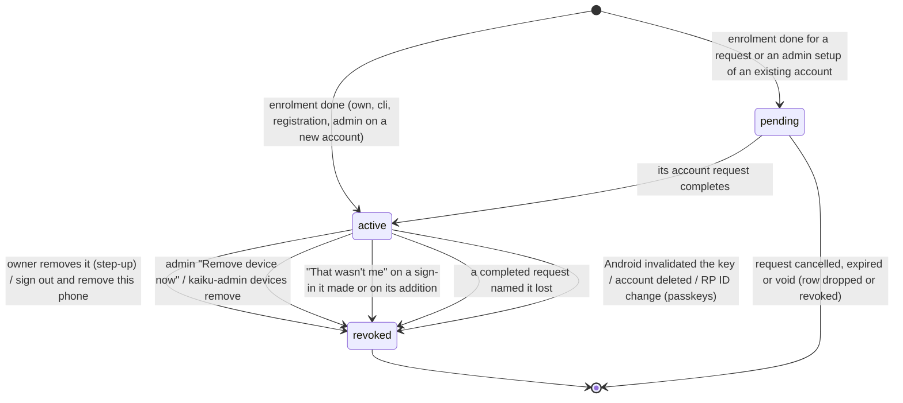
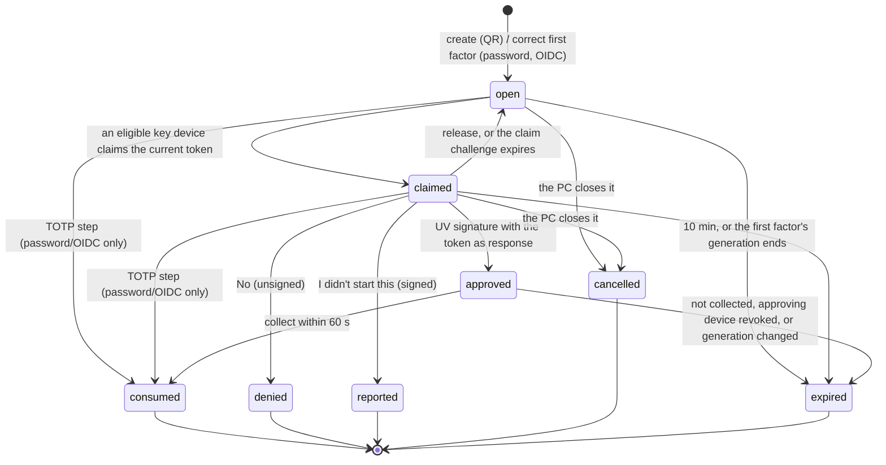
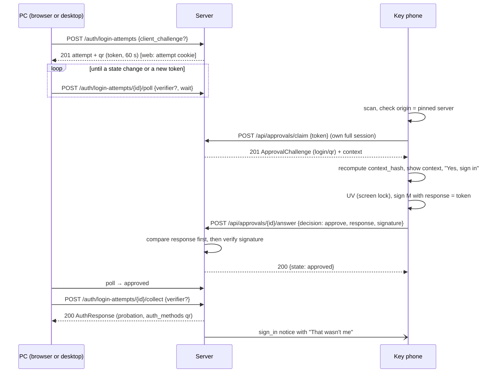
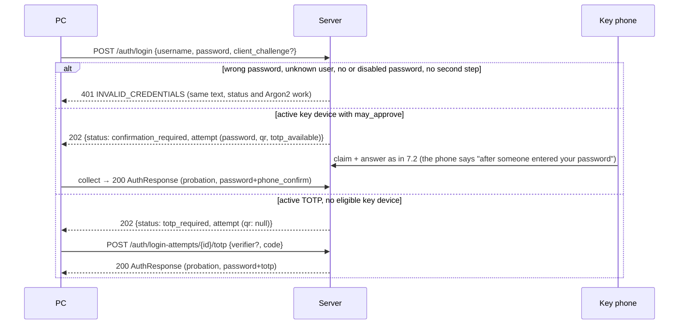
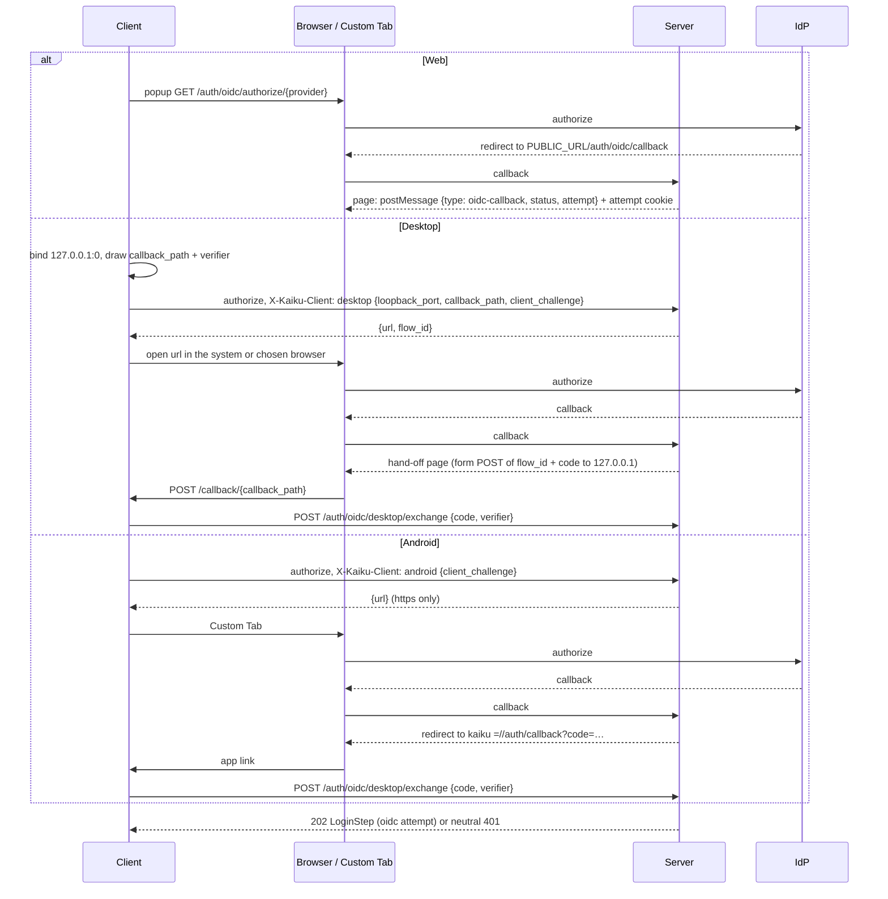
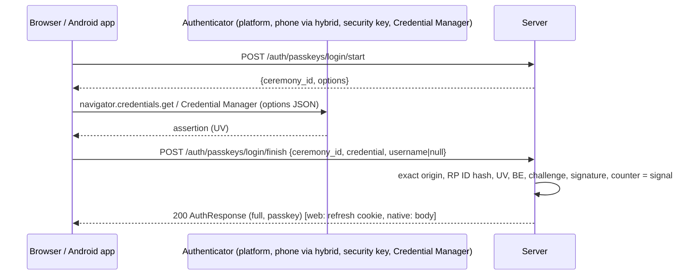
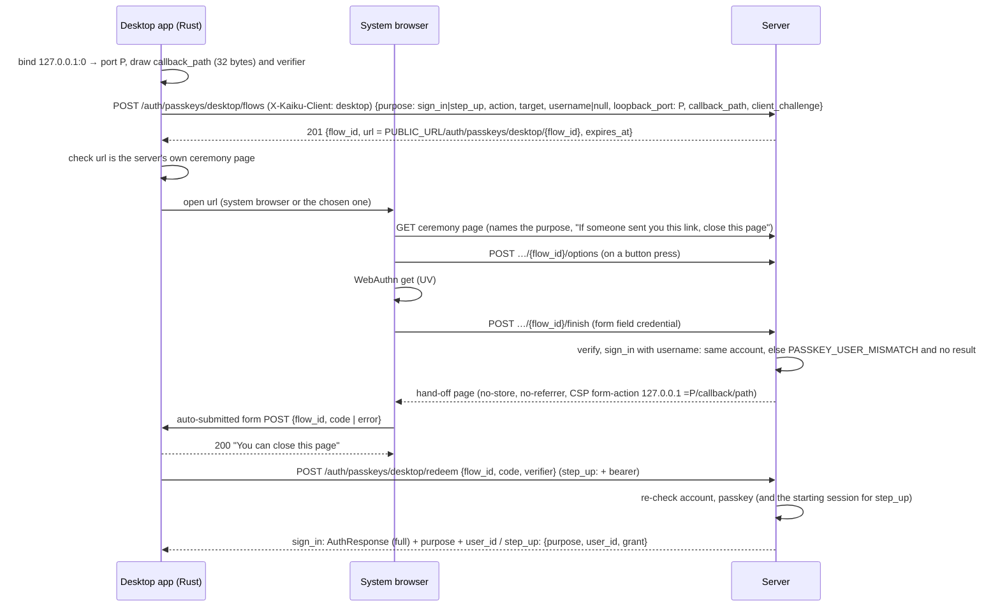
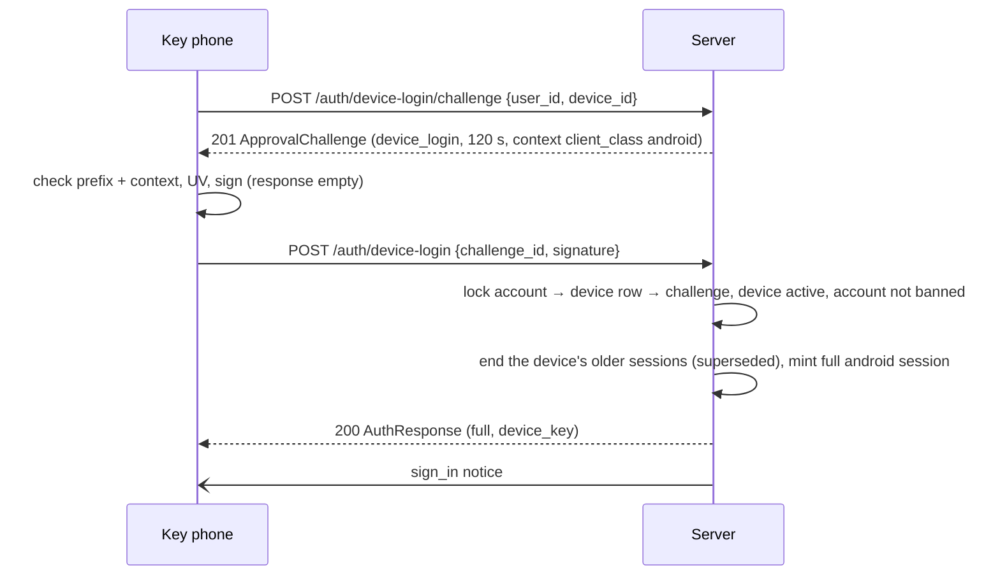
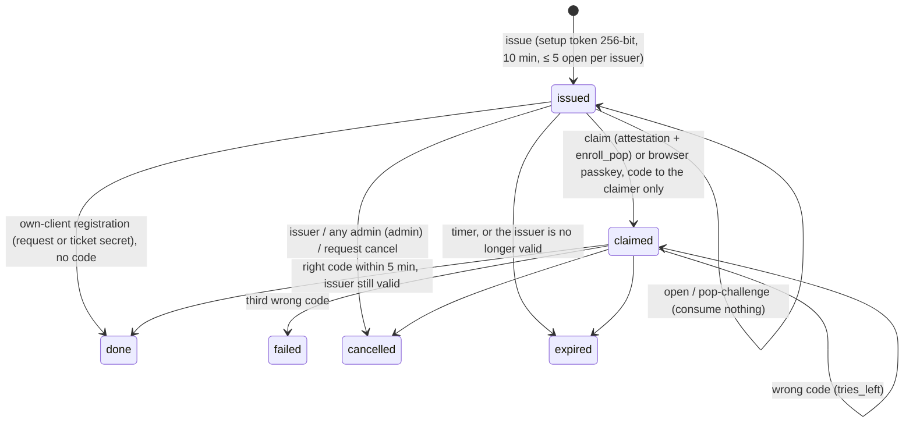
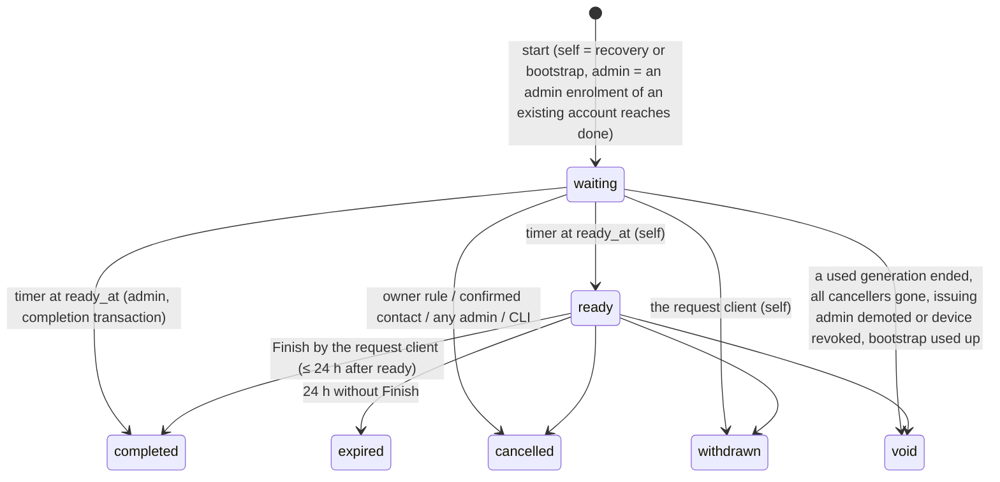

# The v1.0 login: technical reference

This is the security model of the Kaiku v1.0 login as the code on `main` (v1.0.0-rc.3)
implements it. It is written for operators who want to understand the guarantees, for reviewers,
and for client authors. Where the design documents and the code differ, this page describes the
code and says so in a **Code note**.

Sources: the design spec `2026-11-02-phone-key-login-and-simple-app-design.md` (revision 5), the
contracts C26–C29 with their amendments in `2026-10-22-v1-family-contracts.md` (both on the design
branch), the implementation notes in `docs/superpowers/plans/notes/2026-11-03-*`, and the code in
`server/src/auth/`, `server/src/approvals/`, `server/src/security_events/`, `server/src/cli/` and
`server/src/admin/`. The module overviews are `server/src/auth/AGENTS.md` and
`server/src/approvals/AGENTS.md`.

## Contents

1. [Threat model and goals](#1-threat-model-and-goals)
2. [Authenticators](#2-authenticators)
3. [Assurance classes and the two guards](#3-assurance-classes-and-the-two-guards)
4. [Sessions: refresh rotation and caps](#4-sessions-refresh-rotation-and-caps)
5. [Device signatures: `kaiku-sig-v1` (C26)](#5-device-signatures-kaiku-sig-v1-c26)
6. [Key devices and attestation](#6-key-devices-and-attestation)
7. [Sign-in flows](#7-sign-in-flows)
8. [Enrolment (SM2)](#8-enrolment-sm2)
9. [Step-up grants](#9-step-up-grants)
10. [Account requests (SM3)](#10-account-requests-sm3)
11. [Security events and notices (C28)](#11-security-events-and-notices-c28)
12. [Concurrency: the B.7 rules and lock order](#12-concurrency-the-b7-rules-and-lock-order)
13. [Per-account counters](#13-per-account-counters)
14. [What is deliberately not a security signal](#14-what-is-deliberately-not-a-security-signal)
15. [Known residual risks and coordinator decisions](#15-known-residual-risks-and-coordinator-decisions)
16. [Timers and constants](#16-timers-and-constants)
17. [Error-code reference](#17-error-code-reference)

## 1. Threat model and goals

The target is NIST SP 800-63B-4 AAL2 for every account with a phishing-resistant option offered
(passkeys), and OWASP ASVS 5 Level 2 for authentication and session management. AAL3 is a
non-goal. The design defends against:

- an attacker who knows a password and spams confirmations (there are no approval prompts);
- QR phishing (QRLjacking): a relayed QR sign-in yields only a chat-only session;
- a stolen browser or desktop session becoming a permanent takeover (it cannot add or remove
  authenticators);
- a family locked out by IP blocks on its shared address (strong paths are never IP-blocked);
- recovery that is weaker than sign-in (every recovery waits and can be cancelled through
  independent routes);
- e-mail as a key (there is no e-mail login or reset of any kind).

Out of scope: software already running on the user's own computer (as for any loopback hand-off,
RFC 8252), a compromised server, iOS.

## 2. Authenticators

| Authenticator | Role | Session it creates |
|---|---|---|
| Passkey (WebAuthn L3, discoverable, UV required) | sign-in, step-up | full |
| Key device (Kaiku Android app, P-256 key in the Android Keystore, UV per use) | its own sign-in (device-key sign-in), step-up, approver for sign-ins on PCs and for enrolments | full on the device itself; PCs it confirms get probation |
| TOTP | second step after a password or OIDC; one factor of an account request | probation |
| Recovery codes | one factor of an account request only; never a sign-in factor | – |
| Password (optional) | first factor only; one factor of an account request | – |
| OIDC | first factor via the IdP, handled like a password; a fresh OIDC sign-in can be one request factor | probation |

**Strong authenticator** = an `active` passkey or an `active` key device. Lifecycle (SM4):



`pending` and `revoked` authenticators authenticate nothing. A user cannot remove their own last
strong authenticator (`LAST_STRONG_AUTHENTICATOR`); an admin can.

**Passwords** are optional, 8–128 characters, no composition rules, checked against a bundled
top-100k breached-password list (SecLists, MIT) and context words (`kaiku`, the user name, display
name and server name, whole and per word of at least 4 characters, case-insensitive substring) →
400 `PASSWORD_REJECTED {reason: length|breached|context}`. Hashed with Argon2id.

**Recovery codes:** 10 codes of 13 characters from the RFC 4648 base32 alphabet (65 bits each),
shown `ABCDE-FGHIJ-KLM`, Argon2-hashed, one generation per set. Verification always runs all 10
hash checks (dummy-padded, also for malformed input) so timing does not reveal anything.

**Credential states and generations.** A password and a TOTP secret are `active`, `throttled` or
`compromised` (the entry and exit table is in the
[admin guide](admin-guide.md#factor-states)). The password, the TOTP secret and the recovery-code
set each have a **generation** that changes when the factor is replaced, removed or marked
compromised. Login attempts and account requests record the generations they used; a new
generation ends them (rule 2, section 12). A throttle starts no generation.

## 3. Assurance classes and the two guards

A session's assurance is set by `session_issue::issue_session_tx` at creation and never changes.

| `auth_methods` | Created by | Assurance |
|---|---|---|
| `["passkey"]` | passkey sign-in | full |
| `["device_key"]` | device-key sign-in of an active key device | full |
| `["qr"]` | QR sign-in confirmed by a key device | probation |
| `["password","phone_confirm"]`, `["oidc","phone_confirm"]` | first factor + phone confirmation | probation |
| `["password","totp"]`, `["oidc","totp"]` | first factor + TOTP | probation |
| `["legacy"]` | every session that existed before the upgrade | probation |

A full session must name exactly one authenticator (DB CHECK `full_needs_authenticator`).

**The authoritative session check** (`session_check.rs`). Every authenticated request, WebSocket
handshake and re-check, the `?token=` download path, refresh and device-key sign-in decide from
the committed `sessions` row, read by primary key:

- live = `ended_at IS NULL AND expires_at > NOW() AND absolute_expires_at > NOW()`, with the user's
  ban state in the same query;
- order: the Valkey denylist first (a hit rejects at once; a miss or an unreachable denylist falls
  through), then the row. A missing, empty or unreachable denylist never makes a session valid;
- no `sid` claim, no row, not live, another user's session, or the system account → 401
  `INVALID_TOKEN`; banned → 403 `ACCOUNT_BANNED`;
- there is **no positive cache** of live sessions; the access JWT's `assurance` claim is display
  data for clients only.

**The two guards:**

1. *Full session* (`guards::require_full`, `require_full_session` layer) → 403
   `FULL_SESSION_REQUIRED` unless the committed row is `full`.
2. *Step-up grant* (`step_up::consume_tx(conn, auth, action, target)`, called **inside** the
   action's transaction) → 403 `STEP_UP_REQUIRED` unless a matching unexpired grant exists for this
   `sid`, whose authenticator is still active.

| Class | Allowed |
|---|---|
| any session, probation included | chat, DMs, voice and calls, WebSocket; `GET /auth/me`, profile name and avatar; notification and preference settings; own-account reads (`/api/me/security`, `/api/me/security-events`, `/api/approval-devices`, `/auth/passkeys`, `/auth/sessions`, `/api/me/account-requests`); `POST /auth/logout`; owner-rule part 2 actions (section 10) |
| full | the recovery contact's confirmation; `/api/admin/*` except `/api/admin/status` (with elevation where it applies); bot token creation and reset, incoming-webhook creation |
| full + step-up | every action of the step-up table (section 9) |
| unchanged | every other route keeps its own permission checks and is open to probation |

## 4. Sessions: refresh rotation and caps

| | Browser (`web`) | Desktop | Android |
|---|---|---|---|
| Access JWT | 15 min (`JWT_ACCESS_EXPIRY`) | 15 min | 15 min |
| Refresh inactivity (sliding) | 7 d (`JWT_REFRESH_EXPIRY`) | 7 d | 7 d |
| Absolute cap from creation | 30 d | 90 d | 90 d, then device-key sign-in |
| Refresh token transport | `__Secure-kaiku_refresh` cookie, HttpOnly, `SameSite=Strict`, `Path=/auth` | response body, kept in Rust (keyring) | response body, Keystore-wrapped storage |

The client class comes from `X-Kaiku-Client: desktop|android`; anything else is `web`.

**Refresh rotation with reuse detection** (`refresh.rs`, RFC 9700 §4.14.2). The refresh JWT carries
`{sub, exp, iat, typ, jti, sid, gen}`, signed by the server's key; the row stores the generation,
`jti`, issue time and retry time. Under the session's row lock:

- `gen` = the row's and the token matches → rotate in place (`gen + 1`, new `jti`, sliding expiry
  capped at the absolute cap). The `sid` stays stable for the whole sign-in;
- `gen` = the row's − 1, presented within **10 s** of that rotation, and no retry in the last
  **24 h** → the **identical** successor again (a lost response; re-signed from the stored
  `jti`/`iat`);
- any other earlier `gen` → reuse: the session ends (`refresh_reuse`) with a `session_ended_reuse`
  notice → 401 `SESSION_REUSED`;
- anything unrecognised (a higher `gen`, a forged token) → 401 `INVALID_TOKEN`, nothing changes;
- legacy tokens (no `gen`) matching the stored hash rotate once into the new format, so a copy made
  before the upgrade is only recognised as reused from the second rotation on;
- inactivity or the absolute cap → 401 `SESSION_EXPIRED` (the cap also ends the row);
- check order: signature → row exists for `sub` → ban (403 `ACCOUNT_BANNED`) → ended or denylisted
  (401 `INVALID_TOKEN`) → absolute cap / inactivity → generation logic.

Clients serialise refreshes: a Web Lock (`kaiku-refresh`) across browser tabs, one Rust task on the
desktop, a single flight on Android.

**Ending sessions** (`revocation::end_sessions_tx`, `end_all_sessions_tx`), inside the transaction
of the change, after its locks and re-checks: set `ended_at` and `end_reason` (rows are kept 30
days) → delete the sessions' elevations and the `admin:elevated:{sid}` cache → write each `sid` to
the denylist (`canis:revoked_sid:{sid}`, TTL = access lifetime + 60 s; a Valkey error is logged and
never stops the transition) → `pg_notify('kaiku_session_ended', …)` in chunks of at most 100 ids →
commit. After commit a listener republishes the end on `user:{id}`; sockets get `error
SESSION_REVOKED` and close 1008. Every socket also re-reads its row at least every 60 s.
End reasons: `logout`, `revoked`, `others_revoked`, `password_changed`, `ban`, `account_deleted`,
`refresh_reuse`, `limit`, `authenticator_revoked`, `superseded`, `repudiated`, `request_completed`,
`upgrade`, `cli`, `absolute_cap`.

**Concurrent sessions:** at most `MAX_SESSIONS_PER_USER` (50) live sessions; a new sign-in beyond
that ends the least recently used one (`limit`, notice `session_ended_limit`).

## 5. Device signatures: `kaiku-sig-v1` (C26)

Every key-device signature answers a single-use server **challenge** of the approvals core
(`server/src/approvals/`). Approvals carry a transferred secret; proofs carry none.

| Kind | Byte | Variants | Answered at | `response` | TTL |
|---|---|---|---|---|---|
| `login` | 0x01 | `qr` 1, `password` 2, `oidc` 3 | `POST /api/approvals/{id}/answer` | the 32 scanned QR token bytes | 120 s from the claim (at most the attempt's deadline) |
| `enroll` | 0x02 | `own` 1, `admin` 2 | `POST /api/approvals/{id}/answer` | the 6 typed digits as ASCII | until the enrolment code expires (≤ 5 min) |
| `device_login` | 0x03 | – | `POST /auth/device-login` | empty | 120 s |
| `device_stepup` | 0x04 | – | `POST /api/approvals/{id}/answer` | empty | 120 s; the grant ≤ 300 s |
| `enroll_pop` | 0x05 | – | `POST /auth/enrollments/claim` | empty | the setup token's lifetime |

`login` is answered approve or report; `enroll` approve only (its "No" is the unsigned deny, which
cancels the enrolment); proofs approve only. Bytes 0x10–0x1F are reserved for v1.1 agent kinds; a
v1.0 device refuses every kind byte it does not know. Every challenge is single use and expires
within 10 minutes (DB CHECK); its `expires_at` is whole seconds.

**Signed message** (`signing.rs`):

```
M            = "kaiku-sig-v1" ‖ kind[1] ‖ challenge_id[16] ‖ nonce[32] ‖ i64be(expires_at)
               ‖ lp(origin) ‖ user_id[16] ‖ device_id[16] ‖ context_hash[32]
               ‖ decision[1] ‖ lp(response)
context_hash = SHA-256("kaiku-sig-context-v1" ‖ kind ‖ C)
lp(x)        = u32be(len(x)) ‖ x
```

- `nonce`: 32 CSPRNG bytes per challenge; with single use and the expiry every signature is
  unreplayable, proofs included.
- `origin`: the ASCII origin of `PUBLIC_URL` (`https://chat.example.com`: lower case, no trailing
  slash). Changing the domain invalidates every device signature.
- `user_id`: the approver (for `enroll_pop` the subject); `device_id`: the answering device's
  per-install id (the same value as its push `device_id`).
- `decision`: approve 0x01, deny 0x02 (reserved, never signed in v1.0), report 0x03.
- UUIDs are 16 bytes in RFC 9562 order; strings are the UTF-8 bytes exactly as received in JSON.

**Canonical contexts C** (field order binding):

| Kind | C |
|---|---|
| `login` | `attempt_id ‖ collection_hash ‖ variant ‖ client_class ‖ lp(client_label) ‖ i64(created_at) ‖ lp(server_name) ‖ lp(place) ‖ lp(username)` |
| `enroll` | `enrollment_id ‖ subject_id ‖ lp(subject_username) ‖ variant ‖ authenticator_type ‖ new_key_hash ‖ lp(label) ‖ claimant_check` |
| `device_login` | `client_class` |
| `device_stepup` | `sid ‖ lp(action) ‖ target_hash ‖ lp(target_label)` |
| `enroll_pop` | `enrollment_id ‖ new_key_hash ‖ attestation_challenge ‖ lp(subject_username)` |

`client_class`: web 1, desktop 2, android 3. `authenticator_type`: key_device 1, passkey 2.
`claimant_check`: none 0 (`own`), in_person 1, called_back 2. `collection_hash` is the attempt's S256
challenge (native) or SHA-256 of its cookie secret (web). `new_key_hash` is SHA-256 of the new key's
SPKI DER, or of the raw passkey credential id. `place` is `""` in v1.0.

**What the device checks before it asks for UV:** the magic; `kind` equals the screen it shows;
the challenge id; `origin` equals its pinned server; `user_id` is its user (for `enroll_pop` the
subject returned with the challenge); `device_id` is itself; `expires_at` lies in the future (60 s
skew); and `context_hash` recomputed from the JSON `context` equals the prefix's. It displays only
values from that parsed context, so the signature covers exactly what the phone showed. The server
sends `signing_prefix` = M up to and including `context_hash`; the device appends `decision ‖
lp(response)`.

**Keys and signatures:** P-256; `public_key` = base64url SPKI DER (Android `getEncoded()`);
`signature` = base64url ASN.1 DER ECDSA-SHA256 over the whole M (the app never prehashes);
verifiers accept high and low `s`.

**Order of the response check:** for `login` the server compares the `response` with the stored
keyed hash first (mismatch → 400 `APPROVAL_RESPONSE_MISMATCH`, nothing changes); for `enroll` it
verifies the signature first, so only the issuing device can spend a try, then compares (wrong →
400 `ENROLL_CODE_WRONG {tries_left}` and the challenge is spent; the third → 410
`ENROLLMENT_FAILED`).

**Golden vectors** are in `mobile/android/app/src/test/resources/golden/kaiku_sig_v1.json`, read by
the server and the Android tests (never regenerated). The test key is public and only for tests.

**Secrets.** Every pre-session secret (QR tokens, collection secrets, setup tokens, typed codes,
claim secrets, request secrets, registration tickets, hand-off codes) is 256 bits from a CSPRNG
(codes: 6 digits by rejection sampling), single use, stored only as an HMAC-SHA256 under
`AUTH_HMAC_KEY` with a domain per purpose, compared in constant time. Never a UUID, never a plain
hash of a code.

## 6. Key devices and attestation

- **One key per device in v1.0:** `K_approve` (P-256), non-exportable, hardware-backed (TEE, or
  StrongBox where available), UV on every use.
- **UV classes** (`uv_class`): `per_use` (API 30+: biometric strong or device credential per
  signature) and `window_10s` (API 26–29 phones with only a PIN, pattern or password: a key with an
  authentication window of at most 10 s, opened by a credential prompt immediately before each
  signature; a documented deviation).
- The app checks for a secure lock screen and a hardware key store **before** anything is scanned
  or typed. Adding a fingerprint later does not invalidate the key; removing the screen lock does,
  and the app then reports `POST /api/approval-devices/{id}/invalidated` (event `key_invalidated`).
- **Attestation minimum** (`approvals/devices/attestation.rs`). The claim carries the attestation
  chain (leaf first, at most 8 certificates of at most 8 KiB each). The chain is stored
  **unverified** (verification against Google's roots and revocation list is deferred to v1.x).
  The server reads the leaf's key-description extension (OID 1.3.6.1.4.1.11129.2.1.17) and refuses
  (400 `DEVICE_UNSUITABLE`):
  - `attestation_missing`: no chain, no extension, or an unreadable one (also an unreadable
    `authTimeout`);
  - `attestation_properties`: security level below TEE (the lower of attestation and KeyMint
    level), no hardware-enforced user authentication (`userAuthType` none or `noAuthRequired`), a
    timeout other than per-use (absent or 0) or 1–10 s for `window_10s`, an attestation challenge
    other than the enrolment nonce, or a leaf that certifies another key than the claimed one.

  This catches app bugs, not a modified app; the residual is listed in section 15.
- **Origin pinning:** a configured app accepts only QR payloads and links of its own server. Only
  an unconfigured app opened with a setup link accepts a server, and it shows the server name first.
- **Screen hardening:** `FLAG_SECURE`, touch filtering when obscured; lock-screen notifications are
  private and never carry an approving action.
- **Re-enrolment on the same install** as an `active` key replaces it (full revocation cascade,
  `authenticator_removed` recorded). A key that would be `pending` (admin setup of an existing
  account, request) never replaces a live key, and no enrolment replaces its own issuer's device:
  400 `ENROLLMENT_DEVICE_IN_USE`.

## 7. Sign-in flows

### 7.1 Login attempts (SM1)

QR sign-in, password and OIDC sign-ins share one state machine. The PC authenticates every call
after the create with its **collection secret**: native clients send `client_challenge` =
S256(verifier) at the create and the `verifier` on every later call; browsers get the HttpOnly
cookie `__Secure-kaiku_attempt` (`Path=/auth/login-attempts`). Native clients must send the
challenge and browsers must not (`CLIENT_OUTDATED` / `VALIDATION_ERROR` otherwise).



- The attempt lives at most 600 s. The QR token is minted, never stored in plain, and replaced on
  a poll once it is 60 s old or was used by a claim; a rotation resets no counter. The response
  carries `qr` only when it minted a token.
- Poll: `POST /auth/login-attempts/{id}/poll {verifier?, wait: 0..25}` long-polls; at most 32
  concurrent long-polls per process, beyond that answered at once.
- A claim needs an active key device, from its own live full session, with `may_approve` on; for
  `password`/`oidc` attempts it must be the attempt's own user (`LOGIN_ATTEMPT_OTHER_ACCOUNT`).
- Collect within 60 s after `approved`, while the approving device is still active and (password
  attempts) the password generation unchanged; tokens are minted at consumption.
- An F3/F4 attempt that ends without a session after a correct first factor records one
  `sign_in_not_finished` event (coalesced).

QR payload (read only by the in-app scanner; the app registers no intent filter for it):
`kaiku://login/v1?o=<percent-encoded origin>&t=<b64u token>`.

### 7.2 QR sign-in (F2) → probation



A bystander who photographs the QR gets nothing without the PC's collection secret. A phishing page
that shows the victim the attacker's own QR is *not* stopped by this; the result is still only a
probation session (section 15).

### 7.3 Password (or OIDC) plus phone confirmation (F3) and TOTP fallback (F4) → probation



- "Phone not at hand?" is the same TOTP route on a `confirmation_required` attempt, in `open` or
  `claimed` (a claimed challenge becomes void). A TOTP step on a QR attempt → 403 `TOTP_UNAVAILABLE`.
- The TOTP step needs the first factor unchanged and not disabled (else 410 `LOGIN_ATTEMPT_ENDED
  {state: expired}`) and TOTP `active` (else 403 `TOTP_UNAVAILABLE`); a wrong or replayed code → 401
  `INVALID_MFA` and counts (section 13). Each 30 s TOTP step is accepted once per account.
- "I didn't start this" on a password attempt marks the password generation `compromised`.
- `mfa_code` on `/auth/login` → 400 `CLIENT_OUTDATED`. A banned account with a correct password and
  a second step gets 403 `ACCOUNT_BANNED` (coordinator decision, section 15).

### 7.4 OIDC on the web, the desktop and Android (F3 variant)

The OIDC callback never creates a session. It creates an `oidc` login attempt and continues as
7.3 (confirmation QR or TOTP). A passwordless account signed in by OIDC alone gets the neutral
answer. The start's `client_challenge` becomes the attempt's collection challenge.



The one-time code lives 60 s, is single use and is useless without the verifier. The old desktop
`redirect_uri` start answers 400 `OIDC_CLIENT_OUTDATED`; the Android app no longer accepts tokens
from a deep link.

### 7.5 Passkey sign-in (F1) → full

Common profile (`passkeys/rp.rs`, `webauthn-rs =0.5.5`): RP ID = host of `PUBLIC_URL`; the raw
`clientDataJSON.origin` must equal an allowed origin **as a string** (Android `apk-key-hash`
origins first, then the web origin; never `tauri://localhost` or `tauri.localhost`) before the
crate verifies; UV must be set (UV=0 refused); the BE flag must equal the stored value;
`allowCredentials` is empty (discoverable), so a request never reveals whether a user exists.
Registration: `residentKey: required`, UV required, attestation `none`, `excludeCredentials`,
`credProps` (`rk: false` → `PASSKEY_NOT_DISCOVERABLE`). Ceremonies live 300 s in Valkey, single use.
At most 10 active passkeys per account.

**Web and Android** (`POST /auth/passkeys/login/{start,finish}`):



The browser login page also runs conditional mediation (autofill) in the user-name field. Android
requests carry `X-Kaiku-Client: android` and need `assetlinks.json`; there is no Custom Tab
fallback in v1.0.

**Desktop: system-browser hand-off** (C29, F1 rev 4). The desktop app never runs WebAuthn itself
(no Tauri webview can assert for the server's RP ID) and never registers passkeys.



- The flow lives 600 s; the pending result 60 s. The code is a fresh 256-bit value, stored hashed,
  never rendered, logged, or put into an address bar, redirect or any API or polling response. Any
  redeem failure (including flow id + verifier without the code) → 400 `PASSKEY_HANDOFF_INVALID`
  and spends the code.
- The listener answers exactly `POST /callback/<callback_path>` with `Host: 127.0.0.1:P` and a body
  naming its `flow_id`; anything else gets 204 with nothing echoed, and it keeps listening (at most
  16 connections at once).
- The form POST ships; the `fetch()` fallback of the spec does not (it prompts in Chrome and
  Firefox and is blocked as mixed content in Safari).
- The app adopts the tokens only if `/auth/me` is the redeemed `user_id` (`ACCOUNT_MISMATCH`
  otherwise, and the minted session is ended).

Why a forwarded link gains nothing: the victim's genuine assertion produces a code that lands on
the victim's own loopback in a POST body; nothing takes effect before redemption with the
verifier, which only the starting app holds.

### 7.6 Device-key sign-in → full

A key device signs itself in after a lapse (7 days unused, the 90-day cap, a plain sign-out) and
after a new enrolment:



Errors: 404 `KEY_DEVICE_UNKNOWN` (also the system account), 403 `KEY_DEVICE_REVOKED` (the app deletes
its key and shows setup), 403 `ACCOUNT_BANNED`, 409 `KEY_DEVICE_PENDING {ready_at}`. A wrong
signature does not spend the challenge. Rate class `AUTH_FLOW`, never IP-blocked.

**Code note:** C26 lists `auth_methods` in the device-login `AuthResponse`; the code follows C27,
where `AuthResponse` gains only `session_id`, `assurance` and `absolute_expires_at`. The methods are
on `GET /auth/me` → `session.auth_methods`.

## 8. Enrolment (SM2)

One mechanism enrols a key device or passkey for every issuer.

| Variant | Issued by | Precondition | Code typed on | Result |
|---|---|---|---|---|
| `own` | an active key device (`POST /auth/enrollments`) or a full PC session | key device: `device_stepup` for `enrollment.issue`, `may_approve` on; PC: a passkey grant, consumed at issue and recorded with its session and passkey | the issuing screen (key device: an `enroll` approval with UV; PC: `…/{id}/confirm`) | active |
| `admin` | an admin's own active key device (`POST /api/admin/users/{id}/enrollments`) | `admin.enrollment.issue` step-up per code; target ≠ the admin; claimant check; existing account: no open request and an independent canceller | the issuing key device, `enroll` approval with UV | active for a new account, else pending + admin request |
| `request` | a `ready` account request (`/auth/account-requests/current/enrollments`) | the request secret | the request client | pending until "Finish" |
| `registration` | a registration ticket (`/auth/registration/enrollments`) | ticket ≤ 30 min old and unbound | the ticket client | active |
| `cli` | `kaiku-admin enroll` | root on the host | the CLI | active |



New-device routes (public, rate class `AUTH_FLOW`):

- `POST /auth/enrollments/open {setup_token}` → `{server_name, enrollment_nonce, expires_at}`;
  consumes nothing, takes no lock (a POST so the token stays out of URLs and logs);
- `POST /auth/enrollments/pop-challenge {setup_token, device_id, public_key}` → the `enroll_pop`
  challenge and the subject's name; one live challenge per enrolment;
- `POST /auth/enrollments/claim {setup_token, challenge_id, signature, public_key,
  attestation_chain, label, uv_class, api_level}` → `{enrollment_id, state: claimed, code,
  code_expires_at, claim_secret}`, or, with the issuing client's own request secret or ticket,
  `{state: done, authenticator_state, ready_at}` without a code;
- `POST /auth/enrollments/status {enrollment_id, claim_secret, wait: 0..25}` (browser: the
  `__Secure-kaiku_enroll` cookie) → `{state, authenticator_state, ready_at}`; 404 only for an
  unknown id or a wrong secret;
- browser passkey claims: `POST /auth/enrollments/passkey/{start,finish}`.

Setup link: `{PUBLIC_URL}/setup#v=1&t=<b64u token>`; the token is in the fragment, so neither the
server nor a link preview receives it. On a phone the `/setup` page offers "Open in Kaiku"
(`intent://setup/v1?o=…&t=…`); App Links only for hosts in the build's `kaikuAppLinkHosts`.

The issuing screen names the claimer as "a device calling itself '<label>'" because the label is
self-reported. The 256-bit token is the binding secret; the 6-digit code only checks that the
claiming device is the one in front of the person at the issuing screen.

## 9. Step-up grants

A grant (`step_up_grants`) is `{sid, action, target_hash, via: passkey|device, authenticator,
expires_at ≤ 300 s, used_at}`. `target` is a canonical string: a lowercase UUID, the literal
`others`, or `""`; `target_hash = SHA-256(lp(target))`. Only a passkey assertion by a passkey of the
session's account (`POST /auth/passkeys/step-up/{start,finish}`, or the desktop flow) or a
`device_stepup` signature by the session's own key device (`POST /api/approvals/step-up {action,
target}` then `…/answer`) produce one. `grant_tx` refuses a grant whose authenticator is not active
or not the caller's. At use the server re-checks that the session is live and full, the
authenticator still active, and action and target match, and consumes the grant in the action's
transaction. A passkey sign-in is never a step-up; a device grant is bound to the phone's own
session and cannot authorise a PC session.

| Action | Target | Consumed by |
|---|---|---|
| `passkey.add` | – | `POST /auth/passkeys/register/*` (peeked at start, consumed at finish) |
| `passkey.remove` | passkey id | `DELETE /auth/passkeys/{id}` |
| `key_device.remove` | key device id | `DELETE /api/approval-devices/{id}` |
| `enrollment.issue` | – | `POST /auth/enrollments` (`own`) |
| `password.set` / `password.remove` | – | `POST` / `DELETE /auth/me/password` |
| `totp.set` / `totp.remove` | – | `/auth/mfa/setup` (peek) + `/auth/mfa/verify` / `/auth/mfa/disable` |
| `recovery_codes.create` | – | `POST /auth/recovery-codes` |
| `identity.link` / `identity.unlink` | – / identity id | `/auth/me/identities/authorize/{provider}` / `DELETE /auth/me/identities/{id}` |
| `sessions.end` | session id or `others` | `DELETE /auth/sessions/{id}`, `DELETE /auth/sessions` |
| `recovery_contact.set` | contact id, `""` to remove | `PUT` / `DELETE /api/me/recovery-contact` |
| `request.cancel` | request id | `POST /api/account-requests/{id}/cancel` |
| `event.repudiate` | security event id | `POST /api/me/security-events/{id}/repudiate` |
| `account.delete` | – | `POST /api/me/delete-account` |
| `admin.elevate` | – | `POST /api/admin/elevate` (15-min window) |
| `admin.enrollment.issue` | subject user id | `POST /api/admin/users/{user_id}/enrollments` (one per code) |
| `admin.authenticator.remove` | key device or passkey id | `POST /api/admin/users/{user_id}/authenticators/{id}/remove` |
| `admin.may_approve` | user id | `PUT /api/admin/users/{user_id}/may-approve` |
| `admin.factor.set_state` | user id | `PUT /api/admin/users/{user_id}/factors` |
| `admin.recovery_contact.set` | user id | `PUT /api/admin/users/{user_id}/recovery-contact` |

`admin.*` actions are refused before anything else for a non-admin (403 `NOT_ADMIN`). Each guarded
action records `step_up_action {action, target_label}` besides its own event. Bodies that still
carry `current_password`, `revoke_others` or a TOTP code have them ignored. `GET /auth/reauth/methods`
→ `{passkey, device}` tells clients which method the account has. The old password + TOTP and OIDC
re-auth paths are removed.

**Code note:** the per-member admin routes (setup codes, Remove device now, `may_approve`, factor
states, admin recovery contact) sit in the *non-elevated* admin group: the server requires an admin,
a full session and the action's own grant, not the 15-minute elevation window. The apps open admin
mode first anyway.

## 10. Account requests (SM3)



**Start** `POST /auth/account-requests` (public, `AUTH_FLOW`):

- recovery: `{username, purpose: recovery, recovery_code, second: password|totp|oidc, lost:
  none|all_key_devices}`. Order: `lost` validated → start budget (3 per delay period) → recovery
  code checked first (always 10 Argon2 checks; invalid → the unknown-user answer, nothing counted
  per account) → the code is consumed and the start counted → the second factor (password `active`;
  TOTP in any state; or a fresh OIDC code with `auth_time` ≤ 300 s, re-checked at redemption and
  after the locks) → failure: 401 `REQUEST_FACTOR_INVALID {recovery_codes_left}`;
- bootstrap (needs `bootstrap_open`): `{username, purpose: bootstrap, first: password|oidc,
  totp_code}`, both factors `active`; failures and a delayed TOTP counter answer the neutral 401 so a
  correct password is not revealed;
- → 201 `{request, request_secret?}` (native body; web cookie `__Secure-kaiku_request`,
  `Path=/auth/account-requests`; native header `X-Kaiku-Request-Secret`). Other refusals: 409
  `ACCOUNT_REQUEST_OPEN`, 409 `NO_INDEPENDENT_CANCELLER`.

**Independent cancellers** (`core::independent_cancellers`), recorded as JSON routes at the start
and re-evaluated live (`route_alive`):

- `admin`: every system admin other than the subject and the requesting admin, who holds an active
  strong authenticator now;
- `contact`: the recovery contact if `confirmed_at + ACCOUNT_REQUEST_DELAY_HOURS ≤ start` and the
  contact holds an active strong authenticator;
- `authenticator`: each active key device and passkey of the account (devices named lost
  included).

Part 2 of the owner rule does not count. No route → refused; a route added later never counts; no
route left → `void`.

**Request client** (request secret): `GET`/`DELETE /auth/account-requests/current` (read /
withdraw). While `ready`: one staged strong authenticator (a phone via `…/current/enrollments`, a
passkey via `…/current/passkey/{start,finish}`, or the Android app's own key by a claim with the
request secret), `PUT …/current/password`, `POST …/current/totp` + `…/totp/verify`, `PUT
…/current/recovery-contact {username}`; staging a new authenticator replaces the previous pending
one. `POST …/current/finish` → `{request, recovery_codes}`; no session is minted.

**Completion transaction** (under the account lock): the request is `completed` *before* its
effects (so the cascades of its own changes cannot void it); generations unchanged and a recorded
route left, else 409 `{state: void}`; then it activates the staged authenticator, applies a staged
password or TOTP (new generation, ends `throttled`/`compromised`), revokes devices named lost,
uses up `bootstrap_open`, replaces (self) or invalidates (admin) the recovery codes, cancels open
child enrolments, and if it named devices lost or changed password or TOTP ends every other session
except those of active key devices not named lost (`request_completed`).

**Owner action rule** (`owner_rule.rs`) for Cancel and "That wasn't me":

1. **Part 1:** a step-up by an active strong authenticator of the account that existed before the
   event and is not its subject (a device named lost still qualifies);
2. **Part 2:** only while the account has **no** active strong authenticator: a live session of the
   account (probation included; for "That wasn't me" created before the event) plus a fresh TOTP code
   (TOTP not `compromised`) or a recovery code, which is consumed. Part 2 never revokes an
   authenticator.

Never from the client that started a request (it may only withdraw) or from anything the event
created. For Cancel, also the confirmed contact and any admin (full session + `request.cancel`) and
the CLI. A wrong part-2 code answers `INVALID_MFA` / `INVALID_CREDENTIALS` as on the sign-in paths.

**Cancel effects:** child enrolment and pending authenticator voided; for `self` the factor
generations it used are marked `compromised` (a factor replaced since is untouched); a report
event names who cancelled. A cancel that loses against completion → 409 `ACCOUNT_REQUEST_COMPLETED`.

**"That wasn't me"** (`POST /api/me/security-events/{id}/repudiate {part2|null}`) on repudiable
events:

| Event | Effects |
|---|---|
| `sign_in` | ends the reported session; revokes the passkey or key device that *signed in* (part 1 only); compromises exactly the password/TOTP generations the sign-in recorded |
| `sign_in_not_finished` | compromises the password generation it recorded |
| `step_up_action` | ends the session that made the change; revokes nothing |
| `authenticator_added` | key device or passkey: revoked (part 1); TOTP: that TOTP generation compromised |
| `password_set`, `password_changed` | the generation it made compromised |

An authenticator that only *approved* the event (a relayed QR, a dictated enrolment code, a step-up)
is never revoked. Every compromise cascades by rule 2, so it can void the owner's own open request;
the event's `actions` carry the warning `voids_own_request` / `voids_own_bootstrap`, which the
clients show first. Result: `{event, ended_session_ids, revoked_authenticator_ids, compromised,
voided_request_ids}`; 403 `REPUDIATE_NOT_ALLOWED`, 409 `EVENT_ALREADY_REPUDIATED`.

**Registration tickets** (F8): `POST /auth/register` → 201 `{user_id, username, ticket_expires_at,
registration_ticket?}` (web: cookie `__Secure-kaiku_ticket`, `Path=/auth/registration`), never a
session. Within 30 minutes the ticket binds one passkey, one key device (setup QR, or the Android
app's own key), or TOTP (only with a password; then the account signs in by F4 and gets
`bootstrap_open`). A bound ticket binds nothing more. Accounts that bind nothing are deleted by the
sweep after 30 minutes. The first admin cannot bind TOTP (403 `TOTP_UNAVAILABLE`).

## 11. Security events and notices (C28)

`security_events` is append-only (a trigger refuses updates except one-time `delivered_at` /
`repudiated_at`), readable by its subject, with no delete route; each row writes a
`system_audit_log` row `security.<event_type>` in the same transaction.

| Event type | Severity | `details` |
|---|---|---|
| `sign_in` | normal | `{auth_methods, assurance}` (+ recorded factor generations) |
| `sign_in_not_finished`, `second_factor_failed`, `guessing` | normal | `{factor, count}` |
| `approval_reported` | normal | `{attempt_kind}` |
| `authenticator_added` | high for `key_device`/`passkey`, normal for `totp` | `{type}` |
| `authenticator_removed` | high | `{type, by: self|admin|request|cli}` |
| `key_invalidated` | high | `{}` |
| `recovery_codes_created` | normal | `{}` |
| `password_set`, `password_changed`, `password_removed` | normal | `{}` |
| `password_throttled`, `password_compromised`, `totp_throttled`, `totp_compromised` | high | `{cause: guessing|report|repudiation|cancel|admin|cli}` |
| `step_up_action` | normal | `{action, target_label}` |
| `repudiated` | high | `{event_id}` |
| `request_started`, `request_completed`, `request_cancelled`, `request_withdrawn` | high | `{request_id, purpose, cancelled_by?}` |
| `request_ready_soon`, `request_ready`, `request_expired`, `request_void` | normal | `{request_id, purpose}` |
| `admin_setup` | high | `{mode, admin_user_id, new_account}` |
| `admin_role_granted`, `admin_role_removed` | high | `{by_user_id}` |
| `recovery_contact_named`, `recovery_contact_confirmed`, `recovery_contact_changed` | normal (also to the contact) | `{contact_user_id, previous_contact_user_id?}` |
| `session_ended_reuse`, `session_ended_limit` | normal | `{session_id}` |
| `sessions_ended` | high | `{count, by: admin|cli}` |
| `factor_restored` | high | `{factor, by: admin|cli}` |
| `throttle_reset` | normal | `{factor, by: admin|cli}` |
| `may_approve_changed` | high | `{may_approve, by: admin|cli}` |
| `bootstrap_reminder` | normal | `{}` (every 30 days while `bootstrap_open`) |

**The system account "Kaiku":** fixed id `6b61696b-7500-4000-8000-000000000001`, user name `kaiku`
(reserved), refused on every auth path with that path's unknown-user answer, hidden from user lists,
search, presence, mentions, friend and bot paths. Clients recognise it only by `is_system: true`.

**Delivery** (`security_events/notices.rs`): events go through an outbox and are delivered right
after commit, else by the minute sweep (500 per run, half from the oldest end and half from a
rotating cursor, so a failing event cannot starve the rest). Each notice is a message with
`message_type: "security"` and `security_notice` in the recipient's read-only Kaiku DM (writes there
answer 403 `CHANNEL_READ_ONLY`). Recipients: the subject; for `high`, also the confirmed recovery
contact and every admin other than the subject, each as their own notice. Coalescing: per
recipient, subject and event type, events within 600 s of a notice's first event update that notice
(count, up to 50 events, `events_truncated`). Push `t=security` (FCM data or UnifiedPush JSON),
always high priority, collapse key `security-<notice_id>`, TTL 86400 s, at most one per notice per
60 s, to every push subscription (lapsed key devices, devices named lost, and once to a device that
"Remove device now" just removed). IP and place only in the owner's own copy and the admin log.

**Actions** are computed per reader on every read and listed only where usable: `repudiate`
(`via: step_up|part2`, with the warning), `cancel_request`, `remove_device`, `confirm_contact`.

**Recovery contact:** `PUT /api/me/recovery-contact {user_id}` (full + `recovery_contact.set`),
`DELETE` to remove; admin `PUT /api/admin/users/{user_id}/recovery-contact` (non-admin targets).
Never an admin, the account itself or the system account (`RECOVERY_CONTACT_INVALID`). The contact
confirms with `POST /api/me/recovery-contact-for/{user_id}/confirm` (full, no step-up); a contact
who became admin cannot confirm. `counts_from = confirmed_at + ACCOUNT_REQUEST_DELAY_HOURS`.

## 12. Concurrency: the B.7 rules and lock order

1. **One transaction per transition, serialised per account.** A transition locks, in **one
   statement and ascending id order**, the `users` rows of every account it changes or takes
   authority from (`transition::lock_accounts`, `FOR NO KEY UPDATE`): the subject, the acting admin
   or contact, and the accounts whose open requests record an affected canceller
   (`lock_scope`/`lock_route_change`/`lock_for_start`: read the set, lock, re-check, retry from a
   savepoint if it changed, at most 3 times, then 503). Under the locks it re-checks every
   precondition, consumes its challenge or grant, applies the effect and writes the audit row.
2. **Invalidation cascades** (`approvals/cascade.rs`), in the transaction of their cause: ending a
   session voids its grants, desktop flows and enrolments; revoking an authenticator ends its
   sessions and voids its open challenges, grants, enrolments and `admin` requests; demoting an
   admin voids the `admin` requests they started; a new factor generation ends attempts (`expired`)
   and requests (`void`) that used the old one; a request with no route left is `void`; ending a
   request voids its child enrolment and pending authenticator.
3. **Timers** run in a sweep every minute under rule 1.
4. **Consumption re-checks authorisation:** collect only while the approving device is active and
   the generation unchanged; grants only while session and authenticator are; enrolments only while
   the issuer is valid; requests only while a route remains.

**Lock order:** accounts (one statement) → device rows → session rows → challenges and enrolments
→ login attempts. Device-side transitions (claim, answer, deny, release) lock accounts → device →
session → challenge → attempt; the PC side (collect, TOTP step) locks the attempt's account →
attempt; poll, cancel and the sweep touch only attempt rows. Logout and refresh do not take the
account lock and touch only sessions, grants and enrolments. `FOR NO KEY UPDATE` still conflicts
with itself, so transitions serialise, but it does not block the `FOR KEY SHARE` of foreign-key
inserts (notices, events, sessions), which removed a class of deadlocks. Every claimed deadlock
was reproduced (`40P01`) and pinned by a test (implementation notes).

## 13. Per-account counters

`ratelimit/account.rs` keeps Valkey hashes `ratelimit:acct:password:{sha256(lower(trim(username)))}`
and `ratelimit:acct:totp:{user_id}:{generation}`.

- One Lua script updates count, epoch, the next allowed time and the expiry atomically.
- From the 5th consecutive failure the next try waits `30 s · 2^(n−5)`, at most 3600 s (from the
  12th failure on); 429 `TOO_MANY_ATTEMPTS` + `Retry-After`.
- Every 20th failure records `guessing` (coalesced).
- At 100 the factor becomes `throttled`: the script's `HSETNX` claim (`p:{epoch}:{claimed_at}`) lets
  exactly one failure at or past 100 per epoch apply the effects; the claimant settles or releases
  it by compare-and-set; a claim older than 300 s is taken over. 100 TOTP failures after a correct
  password (sign-in attempt or bootstrap) also mark that password generation `compromised`.
- A success starts a new epoch (`reset_epoch`); effects apply under the account lock only while
  epoch, count and generation still match. **Decision:** effects that already read (≥ 100, epoch E)
  apply even if a success commits concurrently: crossing 100 wrong codes is decisive on its own,
  and the concurrent success may be the attacker's lucky guess.
- The TOTP counter is keyed by generation, so a renewal starts fresh and failures against the old
  secret never throttle the new one.
- Counters expire after 24 h without failures. Valkey down → 503.
- The CLI resets call `reset_epoch` on both counters.

## 14. What is deliberately not a security signal

- **IP addresses, networks and places** decide nothing. Being on the same Wi-Fi or home network
  gives no extra trust, no shorter wait and no in-person exception: a shared network is an inference
  that carrier-grade NAT, VPN exits and misconfigured proxies defeat. IPs are stored for display,
  audit and the per-IP request limits only (taken from forwarding headers only behind
  `RATE_LIMIT_TRUSTED_PROXIES`).
- **No GeoIP.** v1.0 removed the external GeoIP calls at login and refresh; `place` is always empty.
- **Device labels** ("a device calling itself …") are self-reported and shown as such.
- **The passkey signature counter** is a signal only: a regression is audited
  (`auth.passkey.counter_regression`) and the assertion is still accepted; the stored counter keeps
  its high-water mark. (webauthn-rs 0.5.5 would refuse; Kaiku verifies against a working copy with
  counter 0.)
- **The BS (backup state) flag** is stored as risk information only; BE must match.
- **Unverified attestation chains** are stored for a later verifier; only the leaf's reported
  properties are checked.
- **OIDC `amr`/`acr`** values are not mapped to full assurance.
- **Time alone** never authorises anything: a request completes because of its factors, the wait
  and the absence of a cancel.

## 15. Known residual risks and coordinator decisions

Residual risks (spec B.6, as implemented):

1. **Real-time relay of QR and password confirmation.** A phishing page can proxy the real QR code;
   the victim's scan yields a *probation* session for the attacker, which reads and writes chats
   until noticed and ended. It never becomes full. Mitigated by context screens, "I didn't start
   this", notices with "That wasn't me", origin pinning, `may_approve` off for family accounts.
2. **Forwarded desktop ceremony.** Gains nothing unless the victim copies the code out of the
   browser's developer tools; the page warns against forwarded links.
3. **Dictation in the enrolment direction.** A scammer who sees a victim's setup QR (screen sharing)
   can claim it and dictate their phone's code. Limited by the self-reported label, the warning
   text, `may_approve` off (no "Add a phone") and "That wasn't me", which revokes only the new device.
4. **A social-engineered admin.** Limited by the recorded claimant check, the wait for every existing
   account and recorded cancellers that do not run through that admin. A *new* account set up
   remotely has no wait. Where the admin is also the operator, the CLI is an audited, notified
   same-day bypass.
5. **The admin's phone is the root of trust** for admin setups; a malicious admin is not contained,
   but cannot act at once on other admins' accounts.
6. **Stolen request factors** start a request that completes unless cancelled; a cancel marks the
   used generations compromised. The owner's own "That wasn't me" can void their own request (the
   apps warn first); during a bootstrap only an admin can help afterwards.
7. **A stolen phone plus its screen lock** is the key until removed; remove it first ("Remove device
   now").
8. **Full access on a PC needs a passkey;** Linux + Firefox means a FIDO2 security key or Chromium.
9. **Lockout abuse** of phone-less users without a passkey (section 13).
10. **Refresh retry window:** a refresh token stolen within 10 s of its rotation yields the same
    successor; the session ends as soon as either holder presents a token the other spent.
11. **All notification addresses live on this server;** a server that is down notifies nobody (and
    completes nothing).
12. **Documented deviations:** session lifetimes beyond NIST §2.2.3's 24 h / 1 h (a stolen session is
    usable for weeks while used weekly); the 10 s window on PIN-only API 26–29 phones; attestation
    not verified against Google's roots (the server cannot itself confirm per-use UV or hardware
    backing); refresh tokens are bearer tokens (not sender-constrained).
13. **Hostile use of owner-rule part 2** by someone with a session and the TOTP secret or a recovery
    code while the account has no strong authenticator.
14. **Request-notice fatigue:** at most 3 self-service starts per account per delay period.

Coordinator and maintainer decisions recorded in the implementation notes:

- **Signature counter is only a signal** (spec B.1 over the LP plan's DC4), as in section 14.
- **100 failures are decisive** (Codex r4 #1), section 13.
- **`ACCOUNT_BANNED` after a correct password** with a second step is kept: a banned person is told
  so; wrong guesses still count. A wrong password still gets the neutral answer.
- **The web refresh-cookie race.** All tabs of a browser share one HttpOnly refresh cookie. The
  client serialises refreshes with a Web Lock; in a browser without Web Locks, or when a refresh
  response is lost more than once in 24 h, the second presentation of a spent token is reuse and
  ends the session (`SESSION_REUSED`). The user signs in again; the alternative (a longer or
  repeated retry window) would weaken reuse detection.
- **`kaiku` rename:** a pre-existing account named `kaiku` is renamed by the migration rather than
  failing the upgrade.
- **Rate-limit code:** the v1.0 categories (`ApprovalLogin`, `AuthFlow`, `AuthPasskey`) answer 429
  `TOO_MANY_ATTEMPTS` with `Retry-After`; older categories keep `RATE_LIMITED`.
- **Desktop passkey `sign_in` takes an optional `username`** (C29 amendment), so a shared PC does
  not sign in another account's passkey by mistake.
- **Form POST hand-off ships**, no `fetch()` fallback (LP spike B).
- **`webauthn-rs` pinned at `=0.5.5`** (0.6.2 was too new under the 14-day rule).
- **`OFFICIAL_RELEASE_CERT_SHA256` is `None`** until the release certificate is supplied.
- **Banned accounts and admin requests:** a due admin request of a banned account waits and completes
  at the first tick after the ban ends.

Known gaps between spec and clients (rc.3):

- The server supports the Android app's own key as a request's staged authenticator, but the Android
  app opens recovery and "Secure my account" as web pages; there the new phone is staged by scanning
  a setup QR.
- The recovery-contact picker lists only people on the web friends list (Android: people with a DM),
  since the server has no general user search.
- **Code note** on the spec's "notice at 20 failures": the code records `guessing` at every 20th
  failure (coalesced), not only at the 20th.

## 16. Timers and constants

| Value | Default | Where |
|---|---|---|
| Access JWT | 900 s | `JWT_ACCESS_EXPIRY` |
| Refresh inactivity | 7 d | `JWT_REFRESH_EXPIRY` |
| Absolute cap | web 30 d, desktop/Android 90 d | `auth/client_class.rs` |
| Refresh retry window / budget | 10 s / once per 24 h | `auth/refresh.rs` |
| Live sessions per account | 50 (1–1000) | `MAX_SESSIONS_PER_USER` |
| Session re-check on sockets | ≤ 60 s | `config.rs` |
| Denylist TTL | access lifetime + 60 s | `auth/revocation.rs` |
| Login attempt / QR token / claim / collect | 600 s / 60 s / 120 s / 60 s | `auth/login_attempts/core.rs` |
| Long-poll wait / concurrent long-polls | ≤ 25 s / 32 | same |
| Challenge maximum | 10 min | `approvals/core.rs` |
| `device_login`, `device_stepup` challenge | 120 s | `approvals/device_login.rs`, `approvals/handlers.rs` |
| Step-up grant | 300 s | `auth/step_up.rs` |
| Elevation | 15 min | `admin/system.rs` |
| Setup token / code / tries / open per issuer | 10 min / 5 min / 3 / 5 | `approvals/enrollments/mod.rs` |
| Passkey ceremony / desktop flow / pending result | 300 s / 600 s / 60 s | `auth/passkeys/` |
| Active passkeys per account | 10 | `auth/passkeys/mod.rs` |
| OIDC state / hand-off code / request-factor freshness | 600 s / 60 s / 300 s | `auth/login.rs`, `auth/oidc.rs`, `auth/account_requests/recovery.rs` |
| Registration ticket | 30 min | `auth/registration.rs` |
| Account request delay | 24 h (24–72) | `ACCOUNT_REQUEST_DELAY_HOURS` |
| Finish window / ready-soon notice | 24 h / 1 h before | `auth/account_requests/core.rs` |
| Self-service starts | 3 per delay period | `auth/account_requests/recovery.rs` |
| Recovery codes | 10 × 13 base32 characters | `auth/recovery_codes.rs` |
| Password length | 8–128 | `auth/password_policy.rs` |
| Per-account delay / notice / throttle / claim takeover / counter TTL | from 5th: 30 s doubling to 3600 s / every 20 / 100 / 300 s / 24 h | `ratelimit/account.rs` |
| Notice coalescing / push interval / events per notice / sweep batch | 600 s / 60 s / 50 / 500 | `security_events/notices.rs` |
| Bootstrap reminder | 30 d | `auth/security_overview.rs` |
| Security log page | 50 (≤ 100) | `security_events/handlers.rs` |
| Timer sweep | 1 min | `auth/timers.rs` |
| Cleanup of ended sessions, finished challenges and enrolments | 30 d | `db` cleanup jobs |

## 17. Error-code reference

All errors use the body `{"error": CODE, "message": string}`; listed extra fields sit next to
`error`. Clients show their own text per code.

**Sessions and guards**

| Code | Status | Meaning |
|---|---|---|
| `INVALID_TOKEN` | 401 | Token without `sid`, unknown, ended or another user's session; also an unrecognised refresh token |
| `SESSION_REUSED` | 401 | A spent refresh token was presented again; the session ended |
| `SESSION_EXPIRED` | 401 | Inactivity (7 d) or the absolute cap |
| `ACCOUNT_BANNED` | 403 | The account is banned |
| `FULL_SESSION_REQUIRED` | 403 | The action needs a full session |
| `STEP_UP_REQUIRED` | 403 | No valid grant for this action and target |
| `NOT_ADMIN` | 403 | Not a system admin (also for `admin.*` step-ups) |
| `ELEVATION_REQUIRED` | 403 | Admin mode is not open |
| `SERVICE_UNAVAILABLE` | 503 | Valkey or the database is unavailable where it is required |

**Sign-in**

| Code | Status | Meaning |
|---|---|---|
| `INVALID_CREDENTIALS` | 401 | The neutral answer (sign-in, request starts) |
| `INVALID_MFA` | 401 | Wrong or replayed TOTP code (counts) |
| `TOTP_UNAVAILABLE` | 403 | No TOTP, TOTP throttled or compromised, or a TOTP step on a QR attempt |
| `TOO_MANY_ATTEMPTS` | 429 | Per-account delay or a v1.0 request limit; `Retry-After` |
| `CLIENT_OUTDATED` | 400 | A pre-v1.0 request shape (e.g. `mfa_code`, missing `client_challenge`, no desktop header) |
| `OIDC_CLIENT_OUTDATED` | 400 | An old desktop OIDC start |
| `OIDC_HANDOFF_INVALID` | 400 | OIDC one-time code unknown, used, expired or wrong verifier |
| `LOGIN_ATTEMPT_UNKNOWN` | 404 | Unknown attempt or wrong collection secret |
| `LOGIN_ATTEMPT_NOT_READY` | 409 | Collect before approval |
| `LOGIN_ATTEMPT_ENDED` | 410 | `{state}`: the attempt ended |
| `LOGIN_CODE_STALE` | 404 | The scanned token matches nothing |
| `LOGIN_ATTEMPT_CLAIMED` | 409 | Another device holds the claim |
| `LOGIN_ATTEMPT_OTHER_ACCOUNT` | 409 | A password/OIDC attempt of another account |
| `REGISTRATION_TICKET_INVALID` | 404 | Unknown or expired registration ticket |
| `PASSWORD_REJECTED` | 400 | `{reason: length|breached|context}` |

**Approvals and key devices**

| Code | Status | Meaning |
|---|---|---|
| `APPROVAL_NOT_FOUND` | 404 | Unknown challenge, or another device's |
| `APPROVAL_STATE` | 409 | The challenge is not open (or its attempt moved on) |
| `APPROVAL_EXPIRED` | 410 | The challenge expired |
| `SIGNATURE_INVALID` | 400 | The signature does not verify |
| `APPROVAL_RESPONSE_MISMATCH` | 400 | The transferred token does not match |
| `APPROVAL_NOT_ALLOWED` | 403 | `may_approve` off, or a demoted issuer |
| `KEY_DEVICE_REQUIRED` | 403 | Needs the session of an active key device |
| `KEY_DEVICE_UNKNOWN` | 404 | No such key device |
| `KEY_DEVICE_PENDING` | 409 | `{ready_at}`: waits for its request |
| `KEY_DEVICE_REVOKED` | 403 | The key device was revoked |
| `LAST_STRONG_AUTHENTICATOR` | 409 | Would remove the owner's last strong authenticator |

**Enrolment**

| Code | Status | Meaning |
|---|---|---|
| `ENROLLMENT_TOKEN_INVALID` | 404 | Unknown, cancelled or expired setup token; unknown id or wrong claim secret at status |
| `ENROLLMENT_ALREADY_CLAIMED` | 409 | Claimed or done already |
| `ENROLL_CODE_WRONG` | 400 | `{tries_left}` |
| `ENROLLMENT_FAILED` | 410 | Third wrong code |
| `ENROLLMENT_STATE` | 409 | Code expired, or the enrolment or its PC issuer is no longer valid |
| `ENROLLMENT_LIMIT` | 409 | 5 open setup codes per issuer |
| `ENROLLMENT_DEVICE_IN_USE` | 400 | The install is a live key of the account (pending claim) or the issuer's own |
| `ENROLLMENT_TARGET_SELF` | 400 | Admin setup for the admin's own account |
| `DEVICE_UNSUITABLE` | 400 | `{reason: attestation_missing|attestation_properties}` |

**Account requests, owner actions, contacts**

| Code | Status | Meaning |
|---|---|---|
| `ACCOUNT_REQUEST_OPEN` | 409 | One open request per account |
| `NO_INDEPENDENT_CANCELLER` | 409 | No route by which someone else could cancel |
| `REQUEST_FACTOR_INVALID` | 401 | `{recovery_codes_left}`: code consumed, second factor wrong |
| `ACCOUNT_REQUEST_NOT_READY` | 409 | `{state}`: not `ready` (or expired, void, completed) |
| `ACCOUNT_REQUEST_COMPLETED` | 409 | Cancel lost against completion |
| `CANCEL_NOT_ALLOWED` | 403 | Not a canceller of this request |
| `REPUDIATE_NOT_ALLOWED` | 403 | Not repudiable by this reader |
| `EVENT_ALREADY_REPUDIATED` | 409 | Already reported |
| `RECOVERY_CONTACT_INVALID` | 400 | An admin, the account itself, the system account or unknown |
| `ADMIN_TARGET_IS_ADMIN` | 403 | Immediate action on another admin's account |
| `CHANNEL_READ_ONLY` | 403 | Write to the Kaiku DM |

**Passkeys**

| Code | Status | Meaning |
|---|---|---|
| `PASSKEYS_UNAVAILABLE` | 503 | Passkeys not configured |
| `PASSKEY_CEREMONY_INVALID` | 400 | Ceremony expired (300 s) or used |
| `PASSKEY_INVALID` | 400 | Origin, RP ID, UV, BE or signature check failed |
| `PASSKEY_UNKNOWN` | 400 | Not (or no longer) registered; clients signal it unknown |
| `PASSKEY_PENDING` | 409 | `{ready_at}`: waits for its request; never signalled unknown |
| `PASSKEY_USER_MISMATCH` | 400 | Another account's passkey |
| `PASSKEY_NOT_DISCOVERABLE` | 400 | The authenticator made no resident credential |
| `PASSKEY_ALREADY_REGISTERED` | 409 | Already registered |
| `PASSKEY_LIMIT` | 409 | 10 active passkeys |
| `PASSKEY_HANDOFF_INVALID` | 400 | Desktop redemption failed |
| `PASSKEY_CANCELLED` | – | Only as the hand-off `error` field |
