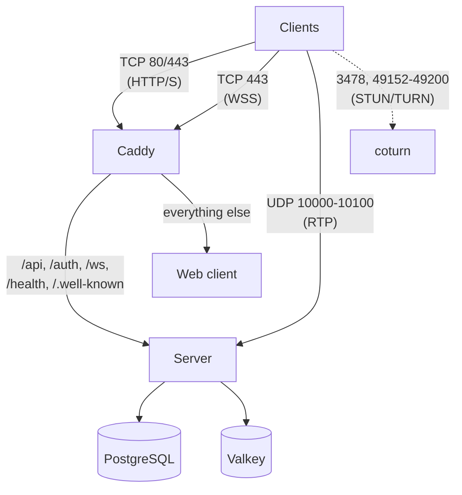

# Kaiku Deployment Guide

This guide covers deploying Kaiku on a self-hosted server.

## Prerequisites

- Linux server (Ubuntu 22.04+ recommended)
- Docker and Docker Compose v2
- Domain name pointing to your server
- Ports 80, 443 (TCP), 10000-10100 (UDP, voice media) and 3478 (TCP and UDP) plus
  49152-49200 (UDP) for the bundled TURN server open

The compose setup runs the server, the web client (`kaiku-web`), Caddy and
the data services. To run the web client behind your own reverse proxy, see
[Web client](web-client.md) for the path routing and its settings.

## Quick Start

```bash
# Clone the repository
git clone https://github.com/Detair/kaiku.git
cd kaiku

# Copy the example settings next to the compose file and edit them
cp .env.example infra/compose/.env
nano infra/compose/.env  # DOMAIN, KAIKU_VERSION, secrets, see Required Settings

# Start services (pulls the published images)
cd infra/compose
docker compose up -d

# Check logs
docker compose logs -f server
```

Docker Compose reads `.env` from the directory of the compose file, so the file
must live in `infra/compose/`.

**Choose the release** with `KAIKU_VERSION`: the version number without a leading
`v`, for example `1.0.0-rc.5`. Compose refuses to start without it. The server
(`ghcr.io/detair/kaiku-server`) and the web client (`ghcr.io/detair/kaiku-web`)
are published under that version for every release, including release
candidates. The `latest` tag moves only for final releases, so it does not
exist until the first one is out; pick the version from the
[releases page](https://github.com/Detair/kaiku/releases).

### Alternative: the beta template

`infra/compose/.env.beta` is a ready-made settings file with monitoring turned
on. It still carries the domain and e-mail address of the project's own beta
host as placeholders; replace `DOMAIN`, `ACME_EMAIL` and `CORS_ALLOWED_ORIGINS`
with yours.

```bash
cd infra/compose
cp .env.beta .env
nano .env  # Replace all CHANGEME values with generated secrets

# Generate secrets:
# POSTGRES_PASSWORD=$(openssl rand -base64 24)
# JWT key pair (Ed25519, base64-encoded PEM):
#   openssl genpkey -algorithm Ed25519 -out jwt.pem
#   JWT_PRIVATE_KEY=$(base64 -w0 < jwt.pem)
#   JWT_PUBLIC_KEY=$(openssl pkey -in jwt.pem -pubout | base64 -w0)
# MFA_ENCRYPTION_KEY=$(openssl rand -hex 32)
# VALKEY_PASSWORD=$(openssl rand -hex 24)
# GRAFANA_ADMIN_PASSWORD=$(openssl rand -base64 16)

# Start with monitoring
docker compose --profile monitoring up -d

# Set up daily backups
crontab -e
# Add: 0 3 * * * /opt/kaiku/infra/scripts/backup.sh >> /var/log/kaiku-backup.log 2>&1
```

`infra/scripts/setup-beta.sh` automates these steps for one fixed domain that is
set inside the script, and builds the server image from the checkout instead of
pulling it. It is not a general installer; `infra/scripts/deploy.sh` likewise
connects to one fixed host. For your own installation, follow the steps above.

## Configuration

### Required Settings

Edit `.env` with your values:

```bash
# Release to run (no leading "v")
KAIKU_VERSION=1.0.0-rc.5

# Your domain (must have DNS pointing to this server)
DOMAIN=chat.yourdomain.com

# Generate secure passwords
POSTGRES_PASSWORD=$(openssl rand -base64 24)
VALKEY_PASSWORD=$(openssl rand -hex 24)   # hex only: it is part of a URL

# JWT signing key pair (Ed25519, base64-encoded PEM)
JWT_PRIVATE_KEY=...
JWT_PUBLIC_KEY=...

# Allowed web origin(s), normally https://<your domain>
CORS_ALLOWED_ORIGINS=https://chat.yourdomain.com

# Email for Let's Encrypt certificates
ACME_EMAIL=admin@yourdomain.com
```

Generate the key pair as shown under the beta template above. The compose file
fails with a message naming the variable when a required one is missing. Only
the variables listed in the compose file reach the server; see
[environment variables](../configuration/environment.md) for the full list and
the note on variables the compose file does not forward.

### Passkeys

Passkeys work without extra settings in browsers and the desktop app. They are bound to your
domain (`PUBLIC_URL`): changing it later invalidates every passkey and key phone. Passkeys in the
Android app need `/.well-known/` routed to the server. See [Passkeys](passkeys.md).

### Voice Chat (WebRTC)

For voice to work, configure:

```bash
# Your server's public IP (required for NAT traversal)
PUBLIC_IP=203.0.113.50

# UDP port range for voice media (ensure firewall allows these)
RTP_PORT_MIN=10000
RTP_PORT_MAX=10100
```

Compose publishes `RTP_PORT_MIN`-`RTP_PORT_MAX` and passes the same values to
the server as `VOICE_UDP_PORT_MIN`/`VOICE_UDP_PORT_MAX`, so the voice server
binds only inside this range. Forward exactly this UDP range 1:1 (same port
numbers) on your router and firewall. Size it for at least 2 x concurrent
voice participants x local addresses of the host, plus headroom (see
[environment variables](../configuration/environment.md)). If you change the
range, update the firewall rules below to match.

**Firewall rules:**
```bash
# UFW
sudo ufw allow 80/tcp
sudo ufw allow 443/tcp
sudo ufw allow 10000:10100/udp
sudo ufw allow 3478          # TURN (TCP and UDP)
sudo ufw allow 49152:49200/udp

# iptables
sudo iptables -A INPUT -p tcp --dport 80 -j ACCEPT
sudo iptables -A INPUT -p tcp --dport 443 -j ACCEPT
sudo iptables -A INPUT -p udp --dport 10000:10100 -j ACCEPT
sudo iptables -A INPUT -p tcp --dport 3478 -j ACCEPT
sudo iptables -A INPUT -p udp --dport 3478 -j ACCEPT
sudo iptables -A INPUT -p udp --dport 49152:49200 -j ACCEPT
```

### Optional: TURN Server

For users behind restrictive NATs, configure a TURN server:

```bash
TURN_SERVER=turn:turn.yourdomain.com:3478
TURN_USERNAME=voicechat
TURN_CREDENTIAL=your-turn-password
```

### Optional: S3 Storage

For file uploads, configure S3-compatible storage (RustFS is the recommended dev backend; any S3-compatible service works for production):

```bash
S3_ENDPOINT=https://s3.yourdomain.com
S3_BUCKET=voicechat
S3_ACCESS_KEY=your-access-key
S3_SECRET_KEY=your-secret-key
```

Compose hands `S3_ACCESS_KEY` and `S3_SECRET_KEY` to the server as
`AWS_ACCESS_KEY_ID` and `AWS_SECRET_ACCESS_KEY`. The bundled `rustfs` service
is used when `S3_ENDPOINT=http://rustfs:9000`; it takes the same two keys.

### Optional: SSO/OIDC

For single sign-on with Authentik, Keycloak, etc:

```bash
OIDC_ISSUER_URL=https://auth.yourdomain.com/application/o/voicechat/
OIDC_CLIENT_ID=your-client-id
OIDC_CLIENT_SECRET=your-client-secret
```

`PUBLIC_URL` is required: the server does not start without it. The compose
file sets it to `https://${DOMAIN}`, so it follows `DOMAIN` and is not set in
`.env`. Sign-in confirmations from key phones and
passkeys are bound to it, so changing your domain later invalidates every key
phone and passkey. It is also used by every OIDC flow, including sign-in from
the desktop app. In your identity provider, register exactly
`https://chat.yourdomain.com/auth/oidc/callback` (`$PUBLIC_URL/auth/oidc/callback`)
as the redirect URI. The desktop app's local `127.0.0.1` address is never sent
to the provider and does not need to be registered.

## Monitoring (Optional)

Start the full monitoring stack alongside core services:

```bash
cd infra/compose
docker compose --profile monitoring up -d
```

This adds Grafana, Prometheus, Tempo, and Loki — all bound to `127.0.0.1` (localhost only). Access via VPN (e.g. Netbird) or SSH tunnel.

**Access Grafana:** `http://localhost:3000` (default: admin / `GRAFANA_ADMIN_PASSWORD` from `.env`)

The "Kaiku Overview" dashboard is auto-provisioned with:
- Request rate, error rate, P95 latency (from OTel spanmetrics)
- Request rate and latency by route
- Server log stream (from Loki)

Make sure `.env` has `OBSERVABILITY_ENABLED=true` (set in `.env.example` and `.env.beta`; the server default is `false`).

## Database Backups

Set up automated daily backups:

```bash
# Test the backup script
./infra/scripts/backup.sh

# Add to crontab (daily at 03:00)
crontab -e
# Add: 0 3 * * * /opt/kaiku/infra/scripts/backup.sh >> /var/log/kaiku-backup.log 2>&1
```

Backups are saved to `/var/lib/kaiku/backups/` with 7-day retention. Configure via environment variables — see the script header for options.

To restore, follow the
[backup and restore runbook](../../ops/backup-restore-runbook.md): it restores
into a fresh database and swaps it in, because loading a dump into the database
that is in use fails on the objects that already exist.

## Services

| Service | Port | Description |
|---------|------|-------------|
| Caddy | 80, 443 | Reverse proxy with automatic TLS; routes server paths to the server and the rest to the web client |
| Server | 8080 (internal), UDP voice range | Kaiku API + WebSocket + voice |
| Web | 8080 (internal) | Web client (`kaiku-web`), see [Web client](web-client.md) |
| coturn | 3478 TCP/UDP, 49152-49200 UDP | STUN/TURN relay, on its own network |
| RustFS | 9000 (internal) | S3-compatible storage (used when `S3_ENDPOINT` points to it) |
| PostgreSQL | 5432 (internal) | Database |
| Valkey | 6379 (internal) | Cache + pub/sub |
| Grafana | 127.0.0.1:3000 | Dashboards (monitoring profile) |
| Prometheus | 127.0.0.1:9090 | Metrics (monitoring profile) |
| Tempo | 127.0.0.1:3200 | Traces (monitoring profile) |
| Loki | 127.0.0.1:3100 | Logs (monitoring profile) |
| OTel Collector | 127.0.0.1:4317 | Telemetry receiver (monitoring profile) |

## Commands

```bash
# Start all services
docker compose up -d

# Stop all services
docker compose down

# View logs
docker compose logs -f [service]

# Build the server image from the checkout instead of pulling it
# (it is tagged with KAIKU_VERSION)
docker compose build --no-cache server
docker compose up -d server

# Database backup (the script also archives the object storage)
./infra/scripts/backup.sh
```

## Updating

Back up first (see [Upgrade playbook](../../ops/upgrade-playbook.md), which also
covers rollback). Then switch to the new release:

```bash
cd kaiku
git fetch --tags && git checkout v<version>   # compose file and migrations of that release
cd infra/compose
# set KAIKU_VERSION=1.0.0-rc.5 in .env
docker compose pull
docker compose up -d
```

The server applies database migrations itself when it starts. Check
`docker compose logs server` and `https://<your domain>/health` afterwards.

**Desktop app and release candidates.** The desktop app updates itself only
between final releases. A release candidate is updated by hand: install the
newer version from the releases page (the same applies to the Android APK).

## Troubleshooting

### Server won't start

```bash
# Check logs
docker compose logs server

# Common issues:
# - Database not ready: wait for postgres healthcheck
# - Missing env vars: check .env file
```

### Voice not working

1. Verify `PUBLIC_IP` is set correctly
2. Check UDP ports are open: `nc -vzu your-server 10000`
3. Check browser console for WebRTC errors
4. Consider adding a TURN server for restrictive NATs

### TLS certificate issues

```bash
# Check Caddy logs
docker compose logs caddy

# Verify DNS is pointing to server
dig +short chat.yourdomain.com

# Check Let's Encrypt rate limits if repeated failures
```

### Database issues

```bash
# Connect to database
docker compose exec postgres sh -c 'PGPASSWORD="$POSTGRESQL_PASSWORD" psql -U "$POSTGRESQL_USERNAME" -d "$POSTGRESQL_DATABASE"'

# Check database size
docker compose exec postgres sh -c 'PGPASSWORD="$POSTGRESQL_PASSWORD" psql -U "$POSTGRESQL_USERNAME" -d "$POSTGRESQL_DATABASE" -c "SELECT pg_size_pretty(pg_database_size(current_database()));"'
```

## Architecture



## Security Checklist

- [ ] Strong `POSTGRES_PASSWORD` (24+ random chars)
- [ ] Own `JWT_PRIVATE_KEY` / `JWT_PUBLIC_KEY` pair, never shared
- [ ] Hex `VALKEY_PASSWORD` set
- [ ] TLS enabled via Caddy (automatic with a valid `DOMAIN` and `ACME_EMAIL`)
- [ ] Firewall configured (only 80, 443, the voice UDP range and the TURN ports open)
- [ ] Regular backups configured
- [ ] Log monitoring enabled

## Support

- Issues: https://github.com/Detair/kaiku/issues
